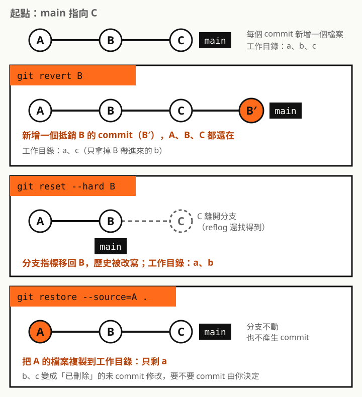

## 一句話區分

| 指令 | 一句話 | 會新增 commit | 會移動分支 | 會改寫歷史 |
| --- | --- | --- | --- | --- |
| `git revert` | 新增一個 commit，**抵銷**指定 commit 的異動 | 會 | 不會（往前多一個） | 不會 |
| `git reset` | 把分支指標**移回**指定的 commit | 不會 | 會 | 會 |
| `git restore` | 把指定來源的檔案**複製**到工作目錄或暫存區 | 不會 | 不會 | 不會 |

Git 官方文件也特別整理過這三個名字相近的指令：revert 是「做一個新的 commit 來還原其他 commit 的變更」；restore 是「從暫存區或其他 commit 還原工作目錄裡的檔案，不會更新分支」；reset 是「更新分支，移動分支的最前端來增加或移除 commit，會改變 commit 歷史」。



以下範例都從同一個起點出發：三個 commit A、B、C，各新增一個檔案 `a.txt`、`b.txt`、`c.txt`。

## git revert：抵銷某個 commit 的異動

```bash
git revert <B 的 commit>
```

revert 會算出 B 這個 commit 改了什麼，產生一個**反向的修改**，再存成新的 commit：

```text
d7318e7 Revert "B 新增 b.txt"
f7fb6a0 C 新增 c.txt
18a05fb B 新增 b.txt
a9e1e28 A 新增 a.txt
```

重點：

- **只抵銷 B 那一次的異動**，B 之後的 C 不受影響。執行後工作目錄剩下 `a.txt`、`c.txt`
- 歷史全部保留，只是多了一個 commit，所以**已經 push 的分支也能安全使用**
- 執行前工作目錄要是乾淨的（沒有未 commit 的修改）
- 如果 B 之後有別的 commit 也改了同一段程式，可能會產生衝突，要手動解決
- 想一次抵銷好幾個 commit、最後再合成一個，可以加 `--no-commit`（`-n`），改完再自己 commit
- 要 revert 的是 merge commit 時，必須用 `-m 1` 這類參數指定要以哪一個 parent 為主線

## git reset：把分支移回某個 commit

```bash
git reset [--soft | --mixed | --hard] <commit>
```

reset 一定會移動 **HEAD 和目前的分支**。之後的 commit 會從分支上消失，歷史因此被改寫。至於暫存區和工作目錄要不要跟著變，由模式決定：

| 模式 | 分支（HEAD） | 暫存區 | 工作目錄 | 適合 |
| --- | --- | --- | --- | --- |
| `--soft` | 移回去 | 不動 | 不動 | 把最近幾個 commit 合併重新 commit |
| `--mixed`（預設） | 移回去 | 改成和目標 commit 一樣 | 不動 | 重新挑選要 commit 的檔案 |
| `--hard` | 移回去 | 改成和目標 commit 一樣 | **覆蓋**成目標 commit 的內容 | 真的要整個丟掉 |

從 C 執行 `git reset <B>` 的實際結果：

```text
--soft  → 分支在 B，c.txt 留在工作目錄，而且已經在暫存區（A  c.txt）
--mixed → 分支在 B，c.txt 留在工作目錄，但變回未追蹤（?? c.txt）
--hard  → 分支在 B，c.txt 直接消失，連 reset 前沒 commit 的修改也一起被覆蓋
```

所以「reset 是回退到該 commit 的狀態」只說對了一半：**分支一定會回去，但檔案只有 `--hard` 才會跟著回去**。

另外，`git reset <檔案>` 這種帶檔名的寫法不會移動分支，只會把該檔案從暫存區撤下來，和 `git restore --staged <檔案>` 效果一樣。

## git restore：把檔案內容複製回來

```bash
git restore [--source=<commit>] [--staged] [--worktree] <路徑>
```

restore 只處理**檔案**：從某個來源把內容複製到工作目錄或暫存區。它不移動分支，也不產生 commit。一定要指定路徑，整個專案就用 `.`。

來源怎麼決定：

| 寫法 | 來源 | 寫到哪裡 | 常見用途 |
| --- | --- | --- | --- |
| `git restore <檔案>` | 暫存區 | 工作目錄 | 放棄還沒 `git add` 的修改 |
| `git restore --staged <檔案>` | HEAD | 暫存區 | 把 `git add` 錯的檔案撤下來（修改還留著） |
| `git restore --source=<commit> <檔案>` | 指定的 commit | 工作目錄 | 把某個檔案拿回舊版本 |
| `git restore --source=<commit> --staged --worktree <檔案>` | 指定的 commit | 兩者 | 同上，並且直接放進暫存區 |

所以「restore 是恢復（複製）該 commit 的程式碼」要補兩點：**不加 `--source` 時來源不是 commit**（一般是暫存區），以及**結果還沒 commit**，要保留得自己 `git add`、`git commit`。

## 該用哪一個

| 情境 | 用法 |
| --- | --- |
| 已經 push 的 commit 有錯，要撤掉 | `git revert <commit>` |
| 還沒 push，想把最近 3 個 commit 合成一個 | `git reset --soft HEAD~3`，再重新 commit |
| 還沒 push，commit 的內容想重新挑 | `git reset HEAD~1`（mixed） |
| 改了一堆，全部不要了 | `git restore .`（未追蹤的新檔案要另外用 `git clean`） |
| `git add` 加錯檔案 | `git restore --staged <檔案>` |
| 某個檔案想拿回上週的版本 | `git restore --source=<commit> <檔案>` |

判斷順序可以這樣想：

1. **只想動檔案，不想動歷史** → restore
2. **要動歷史，而且已經分享給別人了** → revert
3. **要動歷史，而且只有自己在用** → reset

## 容易踩的坑

| 陷阱 | 說明 |
| --- | --- |
| 在已 push 的分支用 reset | 歷史被改寫，必須強制推送（`push --force`），其他人的歷史會對不上。已分享的分支用 revert |
| `reset --hard` 丟掉未 commit 的修改 | reflog 只記得 commit，沒 commit 過的修改被覆蓋就找不回來。下指令前先 `git status` 或 `git stash` |
| `restore --source=<commit> .` 會刪檔案 | restore 預設是 no-overlay 模式：來源裡沒有的已追蹤檔案，會從工作目錄刪掉，讓結果和來源完全一致 |
| 以為 restore 會產生 commit | restore 只改檔案，記得自己 commit |
| revert merge commit 失敗 | 要用 `-m 1` 指定主線的 parent。之後如果想把同一個分支重新合併，要先 revert 這個 revert |
| 以為 revert 會回到那個 commit 的狀態 | revert 只抵銷**那一個** commit 的異動，之後的 commit 都還在 |

## 後悔藥：git reflog

不小心 reset 掉 commit 時，`git reflog` 記錄了 HEAD 最近指向過的位置：

```text
1078eb8 HEAD@{0}: reset: moving to HEAD~1
c63a868 HEAD@{1}: commit: C 新增 c.txt
```

找到原本的 commit 後，`git reset --hard HEAD@{1}` 就能回去。前提是那些內容**曾經 commit 過**。

> 一句話記住：revert 加一筆、reset 退指標、restore 抄檔案。
