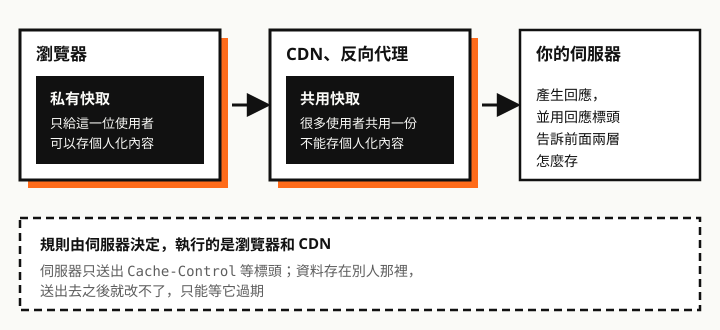

快取的設定常常是「複製貼上能動就好」，直到某天使用者看到舊版頁面，才發現不知道從哪裡查起。這篇只講基礎：**HTTP 快取在哪裡、依什麼規則運作**。

文中每一種設定都用 Chromium 153 實測過：寫一個會記錄請求的 Node 伺服器，讓瀏覽器重複載入同一批資源，看伺服器到底收到幾次請求。

## 快取在哪裡



HTTP 快取不在你的伺服器上，而是在**瀏覽器**和中間的 **CDN、反向代理**。伺服器能做的，只有在回應標頭寫下規則：

```http
HTTP/1.1 200 OK
Cache-Control: max-age=3600
ETag: "v1"
```

這帶來一個重要的後果：**回應送出去之後就收不回來**。你對某個網址說「可以用一年」，使用者的瀏覽器就真的一年不來問，中途你改不了它。

<div class="callout" role="note">
  <p class="callout-label"><span aria-hidden="true">ⓘ</span> 跟 Next.js 的快取不同層</p>
  <p>Next.js 的 Data Cache 存在<strong>你的伺服器</strong>，存的是向上游 API 取得的資料；這篇講的 HTTP 快取存在<strong>瀏覽器和 CDN</strong>，存的是你的伺服器送出去的回應。Data Cache 請看〈<a href="/any/articles/nextjs-fetch-cache-debugging/">Next.js fetch 快取機制與調試</a>〉。</p>
</div>

## 整個機制只回答兩個問題

1. **新鮮度**：這份回應可以直接用多久？
2. **驗證**：過期之後，怎麼確認內容有沒有變？


### 新鮮度：`max-age`

`Cache-Control: max-age=4` 的意思是：這份回應從產生起 4 秒內算新鮮。**新鮮期間，瀏覽器完全不會送請求**。

實測（資源設 `max-age=4`）：

| 時間點 | 伺服器收到的請求 |
| --- | --- |
| 第一次載入 | 一般請求，回 200 |
| 馬上再開一次頁面 | **沒有收到任何請求** |
| 5 秒後再開 | 帶 `If-None-Match: "v1"` 的請求，回 304 |

### 驗證：`ETag` 與 304

`ETag` 是伺服器幫一份內容貼上的**版本標籤**。可以想成跟同事要一份文件：

1. 第一次，同事把整份寄給你，封面寫著「版本 abc123」。
2. 過幾天不確定有沒有改版，你問：「我手上是 abc123，有新的嗎？」
3. 沒改，同事只回一句「沒變，用你那份就好」，不用整份重寄；改了才寄新版，封面換成新的版本號。

HTTP 的對話就是這樣進行的：


| 比對結果 | 伺服器回應 | 傳了多少 |
| --- | --- | --- |
| 一樣，沒改 | `304 Not Modified` | 只有標頭，幾百 bytes |
| 不一樣，改了 | `200 OK`、新內容、新的 `ETag` | 整份內容 |

為什麼需要它？`max-age` 只能說「這份放多久」，時間到了不代表內容真的變了。沒有 `ETag`，瀏覽器只能整份重新下載；有了它，問一下就知道，沒變就省下整份傳輸。

幾個常見疑問：

- **要自己寫嗎？** 通常不用。Nginx、Apache、Express 這類伺服器和框架，對靜態檔會自動產生 `ETag` 並處理 304。常見的算法是內容的雜湊，或「檔案修改時間 ＋ 大小」。
- **長什麼樣子？** 一串用雙引號包起來的字，例如 `"5f3a-18c2b"`，意義只有伺服器自己懂。瀏覽器不解讀，只負責原封不動帶回去。
- **跟 `Last-Modified` 的關係？** 那是較舊的做法，用最後修改時間當版本號，搭配請求的 `If-Modified-Since`，只精確到秒。`ETag` 用內容判斷比較準，兩者都有時以 `ETag` 為準。

**自己看一次**：開發者工具 → Network → 點一個 JS 或 CSS 檔。Response Headers 的 `etag` 就是版本號；重新整理後再點一次，Request Headers 多了 `if-none-match`，Status 顯示 304。

## 最常搞混的：`no-cache` 不是不快取

<div class="callout" role="note">
  <p class="callout-label"><span aria-hidden="true">⚠</span> 重點</p>
  <p><strong><code>no-cache</code> 是「可以存，但每次用之前都要先問伺服器」</strong>。完全不存的是 <code>no-store</code>。</p>
</div>

實測同一個頁面連開好幾次，伺服器看到的差別：

| 回應的 `Cache-Control` | 第二次以後伺服器收到什麼 | 有沒有重傳內容 |
| --- | --- | --- |
| `max-age=3600` | 什麼都沒收到 | 沒有 |
| `no-cache` | 每次都收到帶 `If-None-Match` 的請求，回 304 | 沒有 |
| `no-store` | 每次都收到一般請求，回 200 | 每次都重傳 |

`no-cache` 很適合 HTML：每次都確認，所以使用者一定看到最新版；內容沒變時只花一趟很小的 304。`no-store` 留給真的不該留在磁碟上的資料，例如含個資的頁面。

`max-age=0, must-revalidate` 的效果跟 `no-cache` 幾乎相同，是較早期的寫法。

## 沒寫 `Cache-Control` 不等於不快取

規範允許瀏覽器在沒有明確指示時**自己估一個新鮮期**（heuristic caching），常見做法是取「現在距離 `Last-Modified` 多久」的 10%。

實測兩個都沒寫 `Cache-Control` 的資源：

| 回應標頭 | Chromium 的行為 |
| --- | --- |
| 只有 `Last-Modified`（一年前） | 之後每次導覽都直接用快取，**不送請求** |
| 沒有 `Last-Modified` 也沒有 `ETag` | 每次都重新下載 |

第一種正是「改了檔案，使用者卻一直看到舊的」常見來源：伺服器預設送出 `Last-Modified`，檔案越久沒改，瀏覽器估的新鮮期越長。所以**不要留白，每一類回應都明確寫出 `Cache-Control`**。

## 共用快取：`private`、`public`、`s-maxage`

回應經過 CDN 或反向代理時，它們也會依同一套規則存，而且存的那一份會發給**所有人**。

| 指令 | 意思 |
| --- | --- |
| `private` | 只有瀏覽器可以存，共用快取不能存。含登入者資料的回應要加 |
| `public` | 共用快取也可以存，即使平常不會存的回應（例如帶 `Authorization` 的請求） |
| `s-maxage=60` | 只給共用快取看的新鮮期，會蓋過 `max-age` |

`s-maxage` 的常見用法是「CDN 存久一點，瀏覽器存短一點」：`Cache-Control: max-age=0, s-maxage=300`。

這一節是依 RFC 9111 整理的，**這次沒有架共用快取實測**。各家 CDN 還有自己的預設行為和專屬標頭，要以它們的文件為準。

## 兩個進階指令

### `stale-while-revalidate`：先給舊的，背景更新

`Cache-Control: max-age=2, stale-while-revalidate=60`：過期後 60 秒內，先回舊的那份，同時在背景驗證。使用者不用等。

實測（伺服器故意延遲 1 秒才回應）：

| 時間點 | 有 `stale-while-revalidate` | 只有 `max-age=2` |
| --- | --- | --- |
| 第一次 | 等 1003 ms，拿到 v1 | 等 1005 ms，拿到 v3 |
| 馬上再一次 | 2 ms，v1 | 1 ms，v3 |
| 3 秒後（已過期） | **6 ms，拿到舊的 v1**，背景送出驗證 | **等 1005 ms**，拿到 v4 |
| 再一次 | 2 ms，拿到新的 v2 | — |

代價是過期後的第一次會拿到舊資料。Next.js 的 Data Cache 過期時也是同樣的策略，只是發生在伺服器上。

### `Vary`：同一個網址有多種版本

`Vary: Accept-Encoding` 告訴快取：這個網址的回應會依請求的 `Accept-Encoding` 標頭而不同，要分開看待。常見於壓縮格式和語言。

實測用自訂標頭 `Vary: X-Lang`、`max-age=3600`，依序請求 zh、zh、en、zh：

| 請求 | 伺服器有收到嗎 |
| --- | --- |
| zh | 有 |
| zh | 沒有，用快取 |
| en | 有 |
| zh | **有**，又重新下載 |

Chromium 的快取**每個網址只留一個版本**，換了版本就把前一個蓋掉。所以 `Vary` 的值變化越多，瀏覽器快取的效果越差；能放進網址的差異（例如語言），放網址比較好。

## 重新整理會怎樣

| 操作 | Chromium 實測 |
| --- | --- |
| 點連結、輸入網址（一般導覽） | 照規則走，新鮮就不送請求 |
| 重新整理（F5） | 頁面本身會重新驗證；**頁面裡的 JS、圖片等照規則走**，新鮮就不送請求 |
| 強制重新整理（Ctrl+Shift+R） | 全部重新下載，請求帶 `Cache-Control: no-cache`，不帶 `If-None-Match` |

關於 `immutable`：它的意思是「這個檔案在新鮮期內絕對不會變，重新整理也不用驗證」。依 caniuse 的資料，Firefox 與 Safari 支援，Chrome 不支援。實測 Chromium 重新整理時，有沒有 `immutable` 的資源都沒有重新驗證，所以在 Chromium 上看不出差別；加上去是為了其他瀏覽器。Firefox、Safari 這次沒有實測。

JavaScript 的 `fetch()` 可以用 `cache` 選項指定這次要怎麼用 HTTP 快取。對一個還新鮮的資源實測：

| `fetch(url, { cache })` | 伺服器收到什麼 |
| --- | --- |
| `'default'`、`'force-cache'` | 沒收到，用快取 |
| `'no-cache'` | 帶 `If-None-Match` 的驗證請求，回 304 |
| `'reload'`、`'no-store'` | 一般請求，回 200 |

這是**瀏覽器裡**的 `fetch`。Next.js 伺服器端的 `fetch` 借用了同樣的選項名稱，但控制的是 Data Cache，不是 HTTP 快取。

## 實務上的兩個配方

**檔名帶雜湊的靜態檔**（`app.3f9a1c.js` 這類，打包工具產生的）：

```http
Cache-Control: public, max-age=31536000, immutable
```

內容一變，檔名就變，所以舊網址永遠不需要更新，放心設一年。

**HTML**：

```http
Cache-Control: no-cache
```

HTML 的網址不會變，卻是指向新檔名的入口，所以每次都要確認。

這兩個要搭配使用。最常見的事故是**對 HTML 或檔名不變的檔案設了很長的 `max-age`**：部署新版後，使用者的瀏覽器在期限內根本不會來問，你沒有任何辦法通知它，只能改網址（加版本參數）或等過期。

含登入者資料的回應用 `private, no-cache`；不該留存的敏感資料用 `no-store`。

## 怎麼觀察

- **瀏覽器開發者工具的 Network 面板**：Size 欄顯示 `(memory cache)` 或 `(disk cache)` 表示沒送請求；Status 是 304 表示驗證後沿用。除錯時記得確認「Disable cache」沒有勾，不然看到的不是使用者的情況。
- **`curl -I 網址`**：只看回應標頭，確認伺服器實際送出的 `Cache-Control`、`ETag`。curl 自己不快取，每次都是真的請求。
- **`curl -I -H 'If-None-Match: "v1"' 網址`**：手動送驗證請求，看伺服器會不會回 304。

## 這次沒有測的

- 共用快取（CDN、反向代理）的行為，包含 `private`、`public`、`s-maxage`
- Firefox、Safari
- `must-revalidate`、`stale-if-error`、`Age` 標頭、上一頁／下一頁快取（bfcache）
- Service Worker 的快取，那是另一套機制

## 一句話複習

`max-age` 決定多久不用問，`ETag` 讓問的時候不用重傳；`no-cache` 是每次都問，`no-store` 才是不存。靜態檔靠檔名雜湊設一年，HTML 設 `no-cache`。

參考資料：[RFC 9111: HTTP Caching](https://www.rfc-editor.org/rfc/rfc9111.html)、[caniuse：Cache-Control: immutable](https://caniuse.com/mdn-http_headers_cache-control_immutable)。
