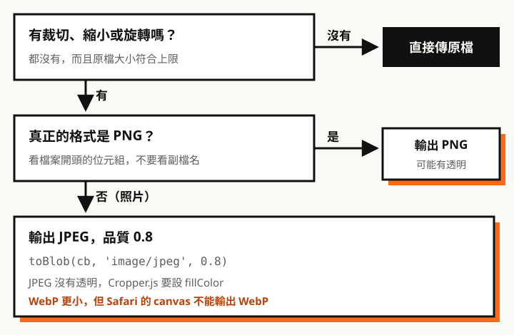

專案裡讓使用者上傳圖片前先裁切，用的是 Cropper.js，搭配 `toDataURL`、`atob`、`new File` 這些原生 API。結果遇到一個怪問題：**使用者上傳後的檔案，比原圖大非常多。**

這篇先實測找出原因，再整理前端控制圖片的必懂知識點，最後是可以直接套用的寫法。

文中會用到 Blob、File、blob URL 這些概念，如果還不熟，可以先看姊妹篇[玩轉 Blob、File 與圖片](/any/articles/blob-file-image/)。

## 先看實測：檔案怎麼變大的

用 Chromium 141 和 Cropper.js 1.7.0，走一遍常見的裁切上傳流程。測試圖是程式合成的照片風格 JPG（3000×2000），以及截圖風格、透明背景的 PNG。


同一張照片，不同輸出方式的結果：

| 輸出方式 | 檔案大小 | 和原檔比 |
| --- | --- | --- |
| 原檔（3000×2000 JPG） | 636 KB | — |
| `toDataURL()`，沒指定格式 | **8.65 MB** | **約 14 倍** |
| `toDataURL('image/jpg', 0.8)`（少一個 e） | **8.65 MB** | 一樣變 PNG |
| `toBlob(cb, 'image/jpeg')`，預設品質 0.92 | 680 KB | 還是比原檔大 |
| `toBlob(cb, 'image/jpeg', 0.8)` | 557 KB | 小一點 |
| 縮到 1600 寬，再 `jpeg 0.8` | **105 KB** | 約 1/6 |

PNG 來源也會變大：截圖 47 KB 重新輸出成 PNG 是 93 KB，透明背景的 logo 從 5.2 KB 變成 19.8 KB。

## 必懂知識點

### 1. 畫到 canvas，就一定會重新編碼

JPG、PNG 都是**壓縮過的檔案**。畫到 canvas 時，瀏覽器會把它解壓成一格一格的像素；再輸出時，是用你指定的格式**從頭壓縮一次**，原本檔案的壓縮結果完全不會保留。

所以：

- **沒改動就不要經過 canvas**，直接上傳原檔
- **重新壓縮未必比較小**：原圖用品質 80 存，你用 0.92 重新壓縮，就會比原圖大
- **PNG 重新輸出幾乎一定變大**：原檔通常經過壓縮工具最佳化，瀏覽器的 PNG 編碼器重視速度，壓得沒那麼小

### 2. 格式：照片用 JPEG，透明用 PNG

| 格式 | 壓縮方式 | 透明 | 適合 | canvas 能輸出 |
| --- | --- | --- | --- | --- |
| JPEG | 有損 | 不支援 | 照片 | 所有瀏覽器 |
| PNG | 無損 | 支援 | 截圖、圖示、透明背景 | 所有瀏覽器（**預設值**） |
| WebP | 有損或無損 | 支援 | 兩者都行，通常最小 | **Safari 不行** |



三個實測確認的陷阱：

- **不指定格式就是 PNG**。`toDataURL()`、`toBlob()` 的預設格式都是 `image/png`
- **格式寫錯也是 PNG**。瀏覽器不認得的格式會默默改成 PNG，不會報錯。`'image/jpg'` 少了 e 就是不認得
- **JPEG 沒有透明**。透明的 PNG 直接轉 JPEG，實測透明處變成**黑色**

WebP 實測更小（照片 0.8 品質是 273 KB，比 JPEG 的 557 KB 小一半），但 Safari 的 canvas 不支援輸出 WebP，會默默給你 PNG。要用的話一定要檢查 `blob.type`，不是 `image/webp` 時改用 JPEG。

### 3. 品質參數：只對 JPEG、WebP 有效

`toBlob(callback, type, quality)` 的第三個參數是 0 到 1：

| 品質 | 照片 3000×2000 |
| --- | --- |
| 0.92（JPEG 預設） | 680 KB |
| 0.8 | 557 KB |
| 0.7 | 503 KB |

- 0.8 左右肉眼通常看不出差別，是常用的平衡點
- **對 PNG 完全無效**：實測 `toBlob(cb, 'image/png', 0.1)` 和不給品質一樣大

### 4. 尺寸：影響最大的一項

從上面的實測可以看到，同樣是 JPEG 0.8，**把 3000 寬縮到 1600 寬，檔案從 557 KB 降到 105 KB**，效果遠大於調品質。

先想清楚圖片實際會顯示多大：大頭貼 400 到 512 就夠，文章內圖 1200 到 1600，全寬橫幅 1920。輸出比顯示大兩倍以上，只是浪費。

### 5. toBlob 比 toDataURL 適合上傳

| API | 輸出 | 用途 |
| --- | --- | --- |
| `canvas.toDataURL()` | base64 字串（data URL） | 少量預覽、塞進 `` |
| `canvas.toBlob()` | 二進位的 Blob | **上傳** |
| `atob()` | base64 → 二進位字串 | data URL 轉回檔案時用 |
| `new File([blob], name, { type })` | 有檔名的 File | 放進 FormData 上傳 |
| `URL.createObjectURL(file)` | 暫時的網址 | 預覽，不用讀成 base64 |

`toDataURL` 加 `atob` 的寫法多繞了一圈：base64 比原始資料多約 1/3（實測 8.65 MB 的 PNG 變成 11.5 MB 的字串），整串還要留在記憶體裡、再逐字元轉回來。改用 `toBlob`，直接拿到二進位：

```js
// ✗ 繞路：toDataURL → atob → Uint8Array → new File
const dataURL = canvas.toDataURL('image/jpeg', 0.8)
const bin = atob(dataURL.split(',')[1])
// …逐字元轉成 Uint8Array…

// ✓ 直接：toBlob → new File
canvas.toBlob((blob) => {
  const file = new File([blob], 'photo.jpg', { type: blob.type })
  // formData.append('image', file)
}, 'image/jpeg', 0.8)
```

Blob、File、data URL、blob URL 之間的關係和更多轉換寫法，整理在[玩轉 Blob、File 與圖片](/any/articles/blob-file-image/)。

### 6. 副檔名不可信

實測把 JPG 改名成 `.png`，瀏覽器給的 `file.type` 就是 `image/png`。**`file.type` 是看副檔名猜的，不是看內容**。如果用它決定輸出格式，這張照片會被當成 PNG 輸出，實測變成 2.9 MB。

要知道真正的格式，讀檔案開頭幾個位元組（檔案簽章）：

| 開頭位元組 | 格式 |
| --- | --- |
| `89 50 4E 47` | PNG |
| `FF D8 FF` | JPEG |

## Cropper.js 的坑

### v1：`getCroppedCanvas()` 預設是原圖解析度

不給選項時，輸出的 canvas 就是**裁切範圍的原始像素大小**。使用者上傳 4000×3000 的手機照片，沒裁多少，輸出就是 4000×3000。

### v1：`maxWidth`／`maxHeight` 會把小範圍裁切放大

直覺上 `maxWidth: 1600` 是「最大 1600」，但實測和讀原始碼發現：它會**先把整張原圖縮到 1600**，裁切結果的寬度預設又取「整張縮小後的寬度」。結果小範圍的裁切被**先縮小、再放大**：

| 截圖 1920×1080，裁切 1152×648 | 輸出尺寸 | 檔案大小 |
| --- | --- | --- |
| 不給選項 | 1152×648 | 50 KB |
| `maxWidth: 1600, maxHeight: 1600` | **1600×900（被放大）** | **147 KB** |

所以不要靠 `maxWidth`，改成**自己算好 `width`、`height` 再傳進去**，下一節的寫法就是這樣做。

### v1：轉 JPEG 要設 `fillColor`

```js
cropper.getCroppedCanvas({ fillColor: '#fff' })
```

沒設的話，透明處輸出成 JPEG 會變黑，官方文件也有提醒。

### v2：預設尺寸變成「畫面上的選取框大小」

Cropper.js 目前最新是 v2，改成 Web Components，取得裁切結果的方法變成 `$toCanvas()`。從原始碼看，**沒給 `width`、`height` 時，輸出的是選取框在畫面上的大小**（CSS 像素），不是原圖解析度，和 v1 剛好相反：v1 容易太大，v2 可能太小。這部分是讀原始碼得知，沒有實測。

## 建議寫法（Cropper.js v1）

把上面的知識點整合成一個函式。四種情況都實測過：

```js
// 讀檔案開頭的位元組判斷真正格式；file.type 只是看副檔名
async function sniffType(file) {
  const b = new Uint8Array(await file.slice(0, 4).arrayBuffer());
  if (b[0] === 0x89 && b[1] === 0x50 && b[2] === 0x4e && b[3] === 0x47) return 'image/png';
  if (b[0] === 0xff && b[1] === 0xd8 && b[2] === 0xff) return 'image/jpeg';
  return file.type;
}

async function exportCropped(cropper, file, { maxSize = 1600, quality = 0.8 } = {}) {
  // 1. 依真正的來源格式決定輸出：PNG 保持 PNG（可能有透明），其他一律 JPEG
  const type = (await sniffType(file)) === 'image/png' ? 'image/png' : 'image/jpeg';

  // 2. 自己算輸出尺寸：只縮小、不放大（不要用 maxWidth／maxHeight）
  const { x, y, width, height, rotate } = cropper.getData(true);
  const scale = Math.min(1, maxSize / width, maxSize / height);
  const canvas = cropper.getCroppedCanvas({
    width: Math.round(width * scale),
    height: Math.round(height * scale),
    imageSmoothingQuality: 'high',
    ...(type === 'image/jpeg' && { fillColor: '#fff' }), // JPEG 沒有透明，填白
  });

  // 3. 用 toBlob，不經過 base64
  const blob = await new Promise((resolve) => canvas.toBlob(resolve, type, quality));

  // 4. 沒裁切、沒縮小、沒旋轉，而且重新編碼反而變大 → 直接上傳原檔
  const { naturalWidth, naturalHeight } = cropper.getImageData();
  const untouched = x === 0 && y === 0 && width === naturalWidth && height === naturalHeight
    && !rotate && scale === 1;
  if (untouched && blob.size >= file.size) return file;

  // 5. 副檔名跟著實際格式走
  const ext = blob.type === 'image/png' ? 'png' : 'jpg';
  const name = file.name.replace(/\.[^.]+$/, '') + '.' + ext;
  return new File([blob], name, { type: blob.type });
}
```

實測結果（`maxSize` 1600）：

| 來源 | 原檔 | 不裁切 | 裁切 60% |
| --- | --- | --- | --- |
| 照片 JPG 3000×2000 | 636 KB | 107 KB（1600×1066） | 124 KB（1600×1066） |
| 截圖 PNG 1920×1080 | 46.9 KB | 94 KB（1600×900） | 50 KB（1152×648） |
| 透明 logo PNG 800×800 | 5.2 KB | **直接用原檔** | 7.9 KB（480×480） |
| JPG 改名成 `.png` | 636 KB | 107 KB，檔名改回 `.jpg` | 124 KB |

截圖 PNG 縮小後仍比原檔大，是知識點 1 提到的 PNG 重新編碼問題。如果後端對 PNG 有大小上限，可以在超過時改輸出 JPEG。

<div class="callout" role="note">
  <p class="callout-label"><span aria-hidden="true">⚠</span> 重點</p>
  <p><strong>前端壓縮是為了省流量和上傳時間，不能取代後端檢查。</strong>使用者可以繞過前端直接上傳，伺服器端仍要檢查檔案格式、大小和尺寸。</p>
</div>

> 一句話記住：照片輸出 JPEG 0.8、限制尺寸、用 toBlob，沒改動就傳原檔；格式看內容不看副檔名。
