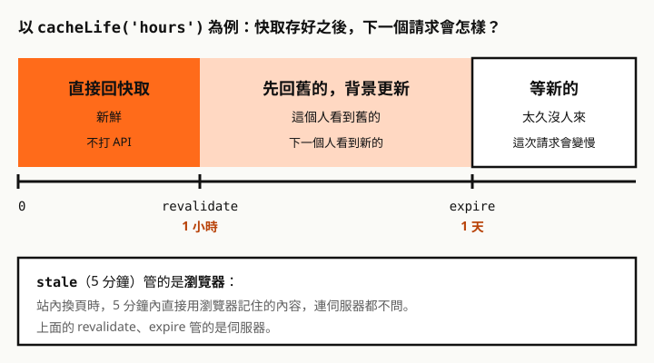

Next.js 16.4 宣布：Cache Components 會在 **Next.js 17 變成預設**，從 16.4 起用 `create-next-app` 建的新專案也已經預設開啟。

但第一次看到 `'use cache'`、`cacheLife`、`cacheTag`、`<Suspense>` 一起出現，很容易一頭霧水。這篇從最基本的觀念開始，每一步都用 **Next.js 16.4.5 的正式版建置（`next build` + `next start`）實測**。

<div class="callout" role="note">
  <p class="callout-label"><span aria-hidden="true">ⓘ</span> 先讀這篇也可以</p>
  <p>還沒開 Cache Components 的專案，fetch 快取的規則完全不同，請看〈<a href="/any/articles/nextjs-fetch-cache-debugging/">Next.js 16 的 fetch 快取</a>〉。文末有新舊寫法的對照表。</p>
</div>

## 一句話：預設什麼都不快取，你標哪裡就快取哪裡

舊的模型是「Next.js 猜」：頁面沒用到 `cookies()` 就自動變成靜態，fetch 的結果就跟著凍結。很多「資料不會更新」的問題都出在這裡。

Cache Components 反過來：**Next.js 不猜，你標**。打 API、查資料庫的程式碼，你只有兩個選擇：

| 選擇 | 寫法 | 什麼時候執行 |
| --- | --- | --- |
| 可以快取 | 函式或元件開頭寫 `'use cache'` | build 時，或第一次請求時；之後拿存好的 |
| 每次都要最新 | 用 `<Suspense>` 包起來 | 每次請求 |

**兩個都沒做，`next build` 直接失敗**。實測錯誤訊息：

```text
Error: Route "/plain": Next.js encountered uncached or runtime data during prerendering.
Ways to fix this:
  - [stream] Provide a placeholder with `<Suspense fallback={...}>` around the data access
  - [cache] For uncached data (`fetch`, database calls): cache the access with `"use cache"`
  - [block] Set `export const instant = false` to allow a blocking route
```

剛開始會覺得麻煩，但這等於強迫每段資料都寫清楚「可不可以快取、存多久」，不會再有「我以為它會更新」的情況。

## 心智模型：一個頁面，三種區塊

開啟之後，Next.js 把頁面看成三種區塊：


| 區塊 | 怎麼寫 | 什麼時候算 | 放在哪 |
| --- | --- | --- | --- |
| ① 靜態 | 什麼都不用做 | build 時 | 外殼 |
| ② 快取 | `'use cache'` | build 時（或第一次請求） | 外殼 |
| ③ 動態 | `<Suspense>` 包起來 | 每次請求 | 外殼裡只有 fallback，內容串流補上 |

①、② 加上 ③ 的 fallback，合起來叫**靜態外殼**（static shell），build 時就做好存起來。使用者一請求就直接送出外殼，動態的部分再一段一段串流補上。這種做法叫 Partial Prerendering（PPR），是 Cache Components 的預設行為。

實測這個頁面：**外殼 112ms 就送達**，讀 cookie 的動態區塊（測試 API 故意延遲 1.5 秒）在 1653ms 補上。使用者不用等最慢的那段，畫面先出來。

完整程式碼：

```tsx
// app/blog/page.tsx
import { Suspense } from 'react'
import { cookies } from 'next/headers'
import { cacheLife, cacheTag } from 'next/cache'

export default function Page() {
  return (
    <>
      <h1>部落格</h1>                       {/* ① 靜態 */}
      <BlogPosts />                          {/* ② 快取 */}
      <Suspense fallback={<p>載入偏好中…</p>}>
        <UserPreferences />                  {/* ③ 動態 */}
      </Suspense>
    </>
  )
}

async function BlogPosts() {
  'use cache'
  cacheLife('hours')
  cacheTag('posts')
  const posts = await getPosts()
  return <ul>{/* … */}</ul>
}

async function UserPreferences() {
  const theme = (await cookies()).get('theme')?.value ?? 'light'
  return <p>主題：{theme}</p>
}
```

`next build` 的路由表會用新符號標示這種頁面：

```text
├ ◐ /blog                    1h      1d
◐  (Partial Prerender)  prerendered as static HTML with dynamic server-streamed content
```

## 第一步：開啟

```ts
// next.config.ts
import type { NextConfig } from 'next'

const nextConfig: NextConfig = {
  cacheComponents: true,
  partialPrefetching: true, // 官方要求明確設定，不設會出現警告
}

export default nextConfig
```

開啟後，`export const dynamic`、`revalidate`、`fetchCache` 這些路由設定都不能再用，留著會報錯。

每段程式要怎麼處理，照這張圖判斷：


## use cache：把函式的結果存起來

### 它在做什麼

把 `'use cache'` 想成**跨請求的記憶**：第一次呼叫時執行函式、把回傳值存起來；之後用**同樣的參數**呼叫，直接拿存好的，函式本身不會再執行。

```ts
import { cacheLife } from 'next/cache'

async function getProduct(id: string) {
  'use cache'
  cacheLife('hours')
  const res = await fetch(`https://api.example.com/products/${id}`)
  return res.json()
}
```

實測依序請求 `id=a`、`a`、`b`、`a`、`b` 共 5 次，API 只被打了 2 次：`a` 一次、`b` 一次。

### 快取鍵：什麼算「同樣的呼叫」

| 組成 | 說明 |
| --- | --- |
| Build ID | 每次 build 都不同，所以**重新部署後全部重算** |
| 函式 ID | 函式在程式碼裡的位置 |
| 參數 | 元件的 props、函式的引數 |
| 捕捉的外層變數 | 函式裡用到的外層變數，自動算進去 |

參數有限制：只能是字串、數字、布林、普通物件、陣列、Date、Map、Set 這類可序列化的值。class 的實例、函式、URL 物件都不行。回傳值可以多一種：JSX。

### 三種放法

| 放在哪 | 快取什麼 | 適合 |
| --- | --- | --- |
| 資料函式開頭 | 資料本身 | 同一份資料給很多元件用，例如 `getProduct()` |
| 元件開頭 | 整個元件的輸出 | 一整塊 UI，例如文章列表 |
| 檔案第一行 | 檔案裡每個 export | 整頁（`page.tsx`）或一整組資料函式 |

**建議優先放在資料函式**，快取的範圍最清楚。快取元件時，`children` 會原樣穿過去、不算進快取，所以快取的外框裡可以放動態的內容。

### 不能在裡面讀 cookies

`'use cache'` 的結果會給所有人共用，所以裡面不能讀 `cookies()`、`headers()`、`searchParams`。實測 build 時的錯誤訊息很直接：

```text
Error: Route "/e1": `cookies()` can't be read inside `"use cache"`.
Read it outside the cached function and pass what you need as an argument.
```

正確做法是在外面讀，把**值**當參數傳進去，值就變成快取鍵的一部分：

```tsx
async function Profile() {                     // 在 Suspense 裡
  const userId = (await cookies()).get('uid')?.value ?? ''
  return <ProfileCard userId={userId} />
}

async function ProfileCard({ userId }: { userId: string }) {
  'use cache'                                  // 每個 userId 一份
  cacheLife('minutes')
  const user = await getUser(userId)
  return <div>{user.name}</div>
}
```

## cacheLife：決定存多久

每個 `'use cache'` 都建議寫 `cacheLife`。不寫的話會套用 `default`，從程式碼上看不出會存多久。

內建的設定檔：

| 設定檔 | 適合 | `stale` | `revalidate` | `expire` |
| --- | --- | --- | --- | --- |
| `default` | 不寫時套用 | 5 分鐘 | 15 分鐘 | 永不過期 |
| `seconds` | 即時資料 | 30 秒 | 1 秒 | 1 分鐘 |
| `minutes` | 動態消息 | 5 分鐘 | 1 分鐘 | 1 小時 |
| `hours` | 一天更新幾次 | 5 分鐘 | 1 小時 | 1 天 |
| `days` | 每天更新 | 5 分鐘 | 1 天 | 1 週 |
| `weeks` | 每週更新 | 5 分鐘 | 1 週 | 30 天 |
| `max` | 幾乎不變 | 5 分鐘 | 30 天 | 1 年 |

三個時間各管一件事：



實測 `cacheLife({ stale: 30, revalidate: 5, expire: 3600 })`，過了 5 秒之後：

| 請求 | 回應標頭 | 頁面資料 |
| --- | --- | --- |
| 第 1 個（已過 revalidate） | `x-nextjs-cache: STALE` | 舊的，同時背景更新 |
| 第 2 個 | `x-nextjs-cache: HIT` | 新的 |

**過期後的第一個請求拿到的是舊資料**，這是刻意的設計，換來的是不用等。

### 太短的快取會變成動態區塊

`expire` 少於 5 分鐘、`revalidate` 是 0，或 `stale` 少於 30 秒的快取，**不會放進外殼**，而是在請求時才執行。內建設定檔裡只有 `seconds` 屬於這種，所以用了 `cacheLife('seconds')` 的元件要包 `<Suspense>`。

另一個相關的錯誤：外層 `'use cache'` 沒寫 `cacheLife`、裡面又包了一個 `seconds` 的快取，build 會失敗：

```text
Error: Route "/e3": A nested `"use cache"` with a short `expire` (under 5 minutes) is inside
an outer `"use cache"` that has no `cacheLife()`.
```

這就是為什麼**每個 `'use cache'` 都要寫 `cacheLife`**。外層寫了，就以外層的時間為準。

## cacheTag：資料改了，主動清掉

`cacheLife` 是「時間到自動更新」，`cacheTag` 是「我說更新就更新」。先貼標籤：

```ts
async function getPosts() {
  'use cache'
  cacheLife('days')
  cacheTag('posts')
  // …
}
```

後台發布文章後，用標籤清掉。三種寫法，實測差別：

| 寫法 | 在哪裡用 | 呼叫後的下一個請求 |
| --- | --- | --- |
| `updateTag('posts')` | 只能在 Server Action | 等新資料（使用者馬上看到自己的修改） |
| `revalidateTag('posts', 'max')` | Server Action、Route Handler | **還是舊的**，背景更新，再下一個才是新的 |
| `revalidateTag('posts', { expire: 0 })` | Server Action、Route Handler | **馬上是新的** |

實測 `revalidateTag` 清掉的是放在**靜態外殼**裡的文章列表，下一次請求外殼就重新產生。`updateTag` 只能在 Server Action 裡呼叫，我沒有另外實測，依官方文件描述。

常見的搭配：文章內容 `cacheLife('max')` + `cacheTag`，編輯存檔時清掉；首頁的最新文章列表 `cacheLife('hours')`，讓它自己定時更新。

## 常見錯誤：頁尾的年份

這個錯誤幾乎每個網站都會遇到。頁尾寫了年份：

```tsx
<footer>© {new Date().getFullYear()} 範例網站</footer>
```

實測 build 失敗：

```text
Error: Route "/e2": Next.js encountered the unstable value `new Date()` while prerendering.
```

`new Date()`、`Date.now()`、`Math.random()`、`crypto.randomUUID()` 每次執行結果都不同，Next.js 要你決定：大家共用一個值，還是每次請求都重算。年份大家共用就好：

```tsx
import { cacheLife } from 'next/cache'

async function Year() {
  'use cache'
  cacheLife('days')
  return <>{new Date().getFullYear()}</>
}

export default function Footer() {
  return <footer>© <Year /> 範例網站</footer>
}
```

實測改完之後 build 成功，頁面是 `○` 靜態，HTML 裡直接是 `© 2026`。真的要每次請求都不同的值（例如請求編號），就在元件裡先 `await connection()`，再用 `<Suspense>` 包起來。

## 進階：快取存在哪裡

這是自架網站最需要搞清楚的地方。

| 內容 | 存在哪 | 重啟 `next start` | 重新部署 |
| --- | --- | --- | --- |
| 靜態外殼（build 時算好的 ①②） | 磁碟上的 HTML | **還在**（實測） | 重新產生 |
| 請求時才產生的 `'use cache'` 結果 | **該行程的記憶體** | **清空**（實測） | 清空 |
| `'use cache: remote'` | 自訂的外部儲存（例如 Redis） | 還在 | 清空（快取鍵含 build ID） |
| `'use cache: private'` | 只在瀏覽器 | — | — |

實測：請求 `?id=a` 讓它存進記憶體，重啟 `next start` 後再請求，API 又被打了一次；同一時間，靜態外殼裡的文章列表沒有重打。

對自架網站的影響：

- **多個行程或多台主機，各有各的快取**：PM2 cluster 開 4 個行程，就有 4 份；`revalidateTag` 只清到收到那個請求的行程
- **記憶體上限**：預設用 LRU 淘汰，大小可以用 `cacheMaxMemorySize` 調整
- **要共用快取**：改用 `'use cache: remote'`，再設定 `cacheHandlers` 接到 Redis 之類的儲存；每次讀取多一趟網路往返，命中率高才划算
- **跟舊模型相反**：舊的 fetch 資料快取會跨部署保留（所以才有「重新 build 資料還是舊的」問題）；`'use cache'` 每次部署都重新開始

`'use cache: private'` 是另一種變體：可以在裡面直接讀 cookies，結果只存在瀏覽器、不會存在伺服器。官方把它定位成「沒辦法把值當參數傳進去」時的備案，一般情況用上面「在外面讀、傳值進去」的寫法就好。

## 開發時怎麼調試

**看函式到底有沒有執行**：在 `'use cache'` 函式裡放 `console.log`，`next dev` 的終端機會這樣顯示：

```text
執行 BlogPosts
 Cache  執行 BlogPosts
 GET /blog 200 in 1756ms
 │ GET http://localhost:4900/posts 200 in 57ms (cache skip)
 Cache  執行 BlogPosts
 GET /blog 200 in 1567ms
```

| 看到的 | 意思 |
| --- | --- |
| 沒有前綴的 `執行 BlogPosts` | 函式**真的執行了** |
| 前面有 ` Cache ` | 從快取**重播**當時的 log，函式其實沒有執行 |

**有 `Cache` 前綴不代表又執行了一次**。實測第二次請求印了好幾行 `Cache 執行 BlogPosts`，但 API 計數沒有增加，fetch 記錄也沒有 `/posts` 那一行。判斷有沒有真的執行，看沒有前綴的 log，或 fetch 記錄（`logging.fetches`，設定方式見 fetch 快取那篇）。

其他工具：

- **建置表**：`○` 全靜態、`◐` 外殼加串流、`ƒ` 全動態；Revalidate、Expire 欄位就是 `cacheLife` 算出來的結果
- **回應標頭**：`x-nextjs-cache` 的 `HIT`、`STALE`，和舊模型一樣
- **`NEXT_PRIVATE_DEBUG_CACHE=1`**：官方文件的 `use cache` 頁面有列出，印出快取的內部動作，輸出很多
- **dev 的錯誤浮層**：開發時就會指出哪個元件沒有快取也沒包 Suspense，不用等到 build

## 從舊模型遷移：對照表

| 舊寫法 | Cache Components |
| --- | --- |
| `fetch(url, { cache: 'force-cache' })` | 包在 `'use cache'` 函式裡 |
| `fetch(url, { next: { revalidate: 3600 } })` | `cacheLife('hours')` |
| `fetch(url, { next: { tags: ['posts'] } })` | `cacheTag('posts')` |
| `export const revalidate = 3600` | `'use cache'` + `cacheLife('hours')` |
| `export const dynamic = 'force-dynamic'` | 刪掉，沒快取的本來就在請求時執行 |
| `export const dynamic = 'force-static'` | `'use cache'` + `cacheLife('max')` |
| `unstable_cache(fn, keys, { revalidate, tags })` | `'use cache'` + `cacheLife` + `cacheTag`，不用自己寫 keys |
| `unstable_noStore()` | 刪掉 |
| 頁面最上層 `await cookies()` | 移到 `<Suspense>` 裡的子元件 |

舊的 fetch 選項和 `unstable_cache` 開啟後**還能用**，可以先開、再慢慢改。還沒準備好的頁面，可以先加 `export const instant = false` 暫時略過檢查；官方有 codemod 一次幫每個頁面加上。但 `new Date()` 這類錯誤不能略過，一定要改。

## 檢查清單

- 每段打 API、查資料庫的程式碼，都決定好是 `'use cache'` 還是 `<Suspense>`
- 每個 `'use cache'` 都有寫 `cacheLife`
- `'use cache'` 裡沒有讀 `cookies()`、`headers()`、`searchParams`，需要的值從外面當參數傳進來
- 用了 `cacheLife('seconds')` 的元件有包 `<Suspense>`
- 頁尾年份這類 `new Date()` 有處理
- 需要「發布後馬上看到」的地方，用 `updateTag` 或 `revalidateTag(tag, { expire: 0 })`
- 自架、多行程或多台主機時，想清楚記憶體快取各自獨立的影響
- 用 `next build` 看路由表的 `○`、`◐`、`ƒ` 是不是你預期的

> 一句話記住：外殼先到、動態後補；能共用的 `'use cache'`，要最新的 `<Suspense>`，兩個都不選，build 會替你選「失敗」。

## 參考資料

- [Caching｜Next.js 文件](https://nextjs.org/docs/app/getting-started/caching)
- [use cache｜Next.js 文件](https://nextjs.org/docs/app/api-reference/directives/use-cache)
- [cacheLife｜Next.js 文件](https://nextjs.org/docs/app/api-reference/functions/cacheLife)
- [revalidateTag｜Next.js 文件](https://nextjs.org/docs/app/api-reference/functions/revalidateTag)
- [Migrating to Cache Components｜Next.js 文件](https://nextjs.org/docs/app/guides/migrating-to-cache-components)
- [Next.js 16.4｜Next.js Blog](https://nextjs.org/blog/next-16-4)
