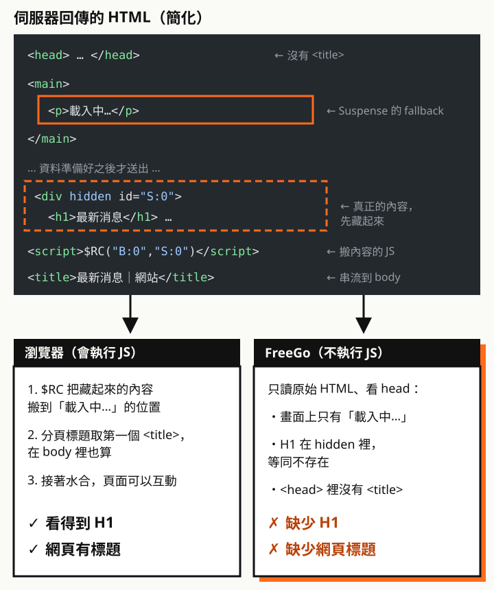

用 FreeGo 檢測 Next.js 網站時，遇到一個怪現象：畫面上明明有 H1，FreeGo 卻判定「缺少 H1」，機器檢測過不了。

整理後發現，關鍵在四件事：**頁面是靜態還是動態**、**有沒有用 Suspense**、**H1 放在哪裡**，以及**檢測工具會不會執行 JavaScript**。

## 先講結論

| 情況 | FreeGo 讀到的 H1 |
| --- | --- |
| SSG 頁面 | ✓ |
| SSG 頁面 + Suspense | ✓（只限正式版） |
| ISR 頁面（`revalidate`）+ Suspense | ✓（只限正式版） |
| **開發模式（`next dev`）的 SSG／ISR 頁面 + Suspense** | **✗ 藏在 `<div hidden>`** |
| SSR 頁面，沒有 Suspense | ✓ |
| 一般的 Client Component（`'use client'`）裡的 H1 | ✓ |
| SSR 頁面，H1 在 Suspense 裡 | **✗ 藏在 `<div hidden>`** |
| SSR 頁面，有 `loading.tsx` | **✗ 藏在 `<div hidden>`** |
| SSR 頁面，layout 用 Suspense 包住 `children` | **✗ 藏在 `<div hidden>`** |
| 靜態頁，H1 在用了 `useSearchParams` 的元件裡 | **✗ HTML 裡沒有 H1** |
| H1 用 `next/dynamic` 的 `ssr: false` 載入 | **✗ HTML 裡沒有 H1** |
| SSR 頁面，H1 在 Suspense 的 fallback | ✓ |
| SSR 頁面，H1 在 Suspense 外面 | ✓ |

> 以上以 Next.js 16.4.2、React 19.3.1 建專案實測：除了標明開發模式的那一列，都是 `next build` 加 `next start` 的正式版，再用關閉 JavaScript 的瀏覽器讀取，模擬 FreeGo 看到的內容。

<div class="callout" role="note">
  <p class="callout-label"><span aria-hidden="true">⚠</span> 重點</p>
  <p><strong>檢查一定要用正式版</strong>（<code>next build</code> 加 <code>next start</code>）。開發模式（<code>next dev</code>）不會預先產生頁面，SSG、ISR 頁面的 Suspense 也會被串流，結果和正式上線不一樣。</p>
</div>

## FreeGo 看到的是哪一份 HTML

Server Component 不論是 SSG 還是 SSR，都會由伺服器回傳 HTML，差別在於**HTML 是什麼時候、用什麼方式組出來的**：

- **SSG**：`next build` 時就把整頁算完，存成一份完整的 HTML
- **SSR**：每次請求才算。為了讓畫面早點出現，Next.js 會**串流**：先送出準備好的部分，慢的部分晚點再補

問題出在「晚點再補」的方式：補上的內容要靠 JavaScript 才會換到畫面上。瀏覽器會執行 JS，看到的是補完後的畫面；**FreeGo 不執行 JS，只讀原始 HTML**，看到的是補之前的樣子。



## 情況一：Suspense 把 H1 藏進 `<div hidden>`

### 串流的 HTML 長怎樣

```tsx
// app/news/page.tsx（SSR 頁面）
export default async function Page() {
  await connection() // 讓頁面在請求時才渲染
  return (
    <Suspense fallback={<p>載入中…</p>}>
      <NewsList /> {/* 裡面有 <h1>最新消息</h1> */}
    </Suspense>
  )
}
```

實際回傳的 HTML（簡化）：

```html
<main>
  <!--$?--><template id="B:0"></template><p>載入中…</p><!--/$-->
</main>
…
<div hidden id="S:0"><section><h1>最新消息</h1>…</section></div>
<script>$RC("B:0","S:0")</script>
```

- 先送出的位置只有 fallback「載入中…」
- 資料準備好後，真正的內容被放在 **`<div hidden>`** 裡送出
- 最後由一小段內嵌的 `$RC` 腳本，把內容搬到 fallback 的位置

沒有 JavaScript，`$RC` 不會執行，H1 永遠留在 `hidden` 裡。被 `hidden` 隱藏的內容不會被呈現，也不在無障礙樹裡，對檢測工具來說就是不存在。

> 嚴格說，把內容換上去的是 React 插在 HTML 裡的 `$RC` 腳本，不是水合（hydration）。水合是之後才發生、讓頁面可以互動的步驟。但兩者都需要 JavaScript，對不執行 JS 的 FreeGo 結果一樣。

### 沒寫 `<Suspense>` 也可能中招

這是最容易漏掉的地方。以下兩種寫法，頁面本身完全沒有 `<Suspense>`，實測 H1 一樣被藏進 `<div hidden>`：

```text
app/news/
  loading.tsx   ← 等同 <Suspense fallback={<Loading />}>，整頁都在裡面
  page.tsx
```

```tsx
// app/news/layout.tsx
export default function Layout({ children }) {
  // layout 包住 children，底下每一頁的 H1 都在 Suspense 裡
  return <Suspense fallback={<p>載入中…</p>}>{children}</Suspense>
}
```

檢查時要往上看：**H1 所在的元件，和它上層的 `loading.tsx`、layout**，任何一層有 Suspense 都算。

### SSG、ISR + Suspense：正式版讀得到

SSG 頁面在 build 時就等所有資料準備好，Suspense 裡的內容直接寫進 HTML，沒有 fallback、也沒有 `<div hidden>`。設了 `revalidate` 的 ISR 頁面也一樣，實測過期後在背景重新產生，H1 仍然直接寫在 HTML 裡。

build 出來的 HTML：

```html
<main><!--$--><section><h1>最新消息</h1>…</section><!--/$--></main>
```

對照情況一開頭的串流 HTML，差別在 Suspense 的標記：

| 標記 | 意思 | H1 |
| --- | --- | --- |
| `<!--$-->` | 內容已經完成，直接寫在這裡 | 讀得到 |
| `<!--$?-->` | 還在等，先放 fallback，內容晚點用 `<div hidden>` 補 | 被藏起來 |

### 開發模式會騙人

**同一個 SSG 頁面，在 `next dev` 底下 H1 會被藏起來**。開發模式不會預先產生頁面，每次請求都即時渲染，Suspense 一律走串流：

| 頁面 | `next dev`（開發模式） | `next build` 加 `next start`（正式版） |
| --- | --- | --- |
| SSG + Suspense | **✗ 藏在 `<div hidden>`** | ✓ |
| ISR + Suspense | **✗ 藏在 `<div hidden>`** | ✓ |
| SSG，沒有 Suspense | ✓ | ✓ |

在開發機上關掉 JS 檢查，很容易得出「SSG 用 Suspense 也不行」的錯誤結論，反過來也可能讓以為修好的問題，在正式環境重新出現。

### 正式版也讀不到的情況

就算用正式版，以下三種情況的 SSG 頁面，Suspense 裡的 H1 一樣讀不到：

**1. 開了 `cacheComponents`，資料沒有快取**

| `cacheComponents` 開啟後 | 結果 |
| --- | --- |
| Suspense 裡的資料**沒有**快取 | 頁面變成「靜態外殼 + 請求時串流」，H1 被藏起來 |
| Suspense 裡的資料加了 `'use cache'` | 內容在 build 時寫進 HTML，H1 讀得到 |

**2. Suspense 裡的元件用了 `useSearchParams`**

build 時不知道查詢參數，HTML 裡只會有 fallback，詳見下方「情況二」。

**3. 頁面其實不是 SSG**

用了 `cookies()`、`headers()`、頁面的 `searchParams` 參數、`connection()`，或不快取的 `fetch`，頁面就會變成請求時才渲染。看 `next build` 最後印出的路由表就知道：

| 符號 | 意思 | Suspense 裡的 H1 |
| --- | --- | --- |
| `○` | 靜態（SSG），後面有時間的是 ISR | ✓ |
| `ƒ` | 動態，每次請求才渲染 | ✗ 被藏起來 |
| `◐` | 靜態外殼 + 請求時串流（`cacheComponents`） | 外殼內的 ✓，串流的 ✗ |

## 情況二：H1 根本沒進 HTML

情況一的 H1 至少還在 HTML 裡，只是被藏起來。下面兩種更徹底：**伺服器回傳的 HTML 裡完全沒有 H1**，只有 fallback。

### 靜態頁裡的 `useSearchParams`

```tsx
'use client'
// components/SearchTitle.tsx
export function SearchTitle() {
  const q = useSearchParams().get('q')
  return <h1>{q ? `搜尋：${q}` : '最新消息'}</h1>
}
```

```tsx
// app/search/page.tsx（靜態頁）
export default function Page() {
  return (
    <Suspense fallback={<p>載入中…</p>}>
      <SearchTitle />
    </Suspense>
  )
}
```

靜態頁在 build 時不知道網址的查詢參數，用了 `useSearchParams` 的元件只能等到瀏覽器才渲染。build 出來的 HTML 只有 fallback，**連 SSG 都救不了**。

### `next/dynamic` 的 `ssr: false`

```tsx
'use client'
const Heading = dynamic(() => import('./Heading'), { ssr: false })
```

`ssr: false` 就是明確要求「伺服器不要渲染這個元件」，HTML 裡自然沒有它。

### `'use client'` 本身沒問題

常見的誤會是「Client Component 就不會出現在 HTML」。實測一般的 `'use client'` 元件一樣會在伺服器先渲染成 HTML，裡面的 H1 讀得到。會出問題的是上面兩種「只在瀏覽器渲染」的寫法。

## 修法

**1. H1 移到 Suspense 外面（最推薦）**

頁面標題通常不需要等資料，直接放在外面：

```tsx
export default async function Page() {
  await connection()
  return (
    <>
      <h1>最新消息</h1>
      <Suspense fallback={<p>載入中…</p>}>
        <NewsList />
      </Suspense>
    </>
  )
}
```

- 有 `loading.tsx` 的路由：把 `loading.tsx` 拿掉，改在頁面裡自己包 Suspense，只包住真正慢的那一塊
- layout 的 Suspense：不要包住整個 `children`，改到各頁面裡包需要等待的區塊
- `useSearchParams`：只把依查詢參數變化的部分包進 Suspense，H1 放外面（實測可行）；H1 一定要顯示查詢字時，改由頁面的 `searchParams` 參數在伺服器讀取，頁面會變成 SSR，但 H1 會直接在 HTML 裡
- `ssr: false`：不要用在 H1 和主要內容上

**2. H1 放進 fallback**

H1 的文字需要等資料才知道時，可以讓 fallback 先帶一個 H1：

```tsx
<Suspense fallback={<><h1>最新消息</h1><p>載入中…</p></>}>
  <NewsList /> {/* 裡面也有 <h1> */}
</Suspense>
```

fallback 會直接出現在初始 HTML，FreeGo 讀得到；有 JS 的瀏覽器換上內容後，fallback 連同它的 H1 被移除，畫面上仍然只有一個 H1。

但要知道這只解決了機器檢測：**不執行 JS 的環境，內容本身還是看不到**，只會停在「載入中…」。

**3. 能靜態就靜態**

資料不是每次請求都不同的頁面，盡量讓它在 build 時產生（SSG），或在開啟 `cacheComponents` 時用 `'use cache'`，內容就會直接寫進 HTML。

## `htmlLimitedBots` 救不了 H1

Next.js 有一個 `htmlLimitedBots` 設定，用來指定「不能執行 JS 的 bot」的 User-Agent，很容易被當成這個問題的解法。實測結果：

| 請求的 User-Agent | Suspense 裡的 H1 |
| --- | --- |
| 一般瀏覽器 | 藏在 `<div hidden>` |
| Googlebot、bingbot、facebookexternalhit | **還是藏在 `<div hidden>`** |
| 設定 `htmlLimitedBots: /.*/` 後的任何 UA | **還是藏在 `<div hidden>`** |

它只讓 **metadata**（`<title>` 等標籤）改成等算完才送出，**不會**讓 Suspense 停止串流。H1 只能用上一節的方式修。它真正能幫上忙的是網頁標題，見文末「順帶一提」。

## 怎麼自己檢查

不用每次都跑 FreeGo，用 Chrome 就能看到 FreeGo 的視角。

<div class="callout" role="note">
  <p class="callout-label"><span aria-hidden="true">⚠</span> 重點</p>
  <p><strong>先 <code>next build</code> 再 <code>next start</code>，用正式版檢查。</strong>開發模式（<code>next dev</code>）會把 SSG、ISR 頁面的 Suspense 也串流，結果和上線後不同，見上方「開發模式會騙人」。</p>
</div>

1. 打開 DevTools，按 `Ctrl`＋`Shift`＋`P`（Mac 是 `Cmd`＋`Shift`＋`P`），輸入「Disable JavaScript」執行
2. 重新整理頁面，看畫面上還有沒有標題
3. 在 Console 執行下面這行，列出每個 H1 是否被藏起來：

```js
[...document.querySelectorAll('h1')].map((h) => [h.textContent, h.closest('[hidden]') ? '被藏起來' : '看得到'])
```

結果是空陣列，代表 HTML 裡根本沒有 H1（情況二）；出現「被藏起來」，就是情況一。

## 判斷流程


## 這算真的無障礙問題嗎

要分兩層看：

- **對多數使用者影響不大**。螢幕閱讀器使用者用的瀏覽器會執行 JavaScript，看到的是補完後的頁面，H1 在
- **對不執行 JS 的環境是真的缺**。檢測工具、部分爬蟲、社群分享預覽，以及關閉 JS 的使用者，只拿得到原始 HTML。以 Suspense 為例，他們連內容本身都看不到，不只是少一個 H1

所以修的時候，目標不只是讓 FreeGo 通過：**頁面的主要內容和標題結構，最好不要依賴 JavaScript 才出現**。H1 移出 Suspense、主要內容能靜態就靜態，這兩件事同時解決了機器檢測和真實的使用情境；把 H1 塞進 fallback，則只解決了前者。

## 順帶一提：網頁標題也可能被判缺失

同樣的檢測，有時還會多一項「缺少網頁標題」。原因不一樣，簡單整理：

- Next.js 15.2 起，`generateMetadata` 預設會串流。**當它在請求時才算、而且比頁面開頭慢**，補上的 `<title>` 會被放進 `<body>`，`<head>` 裡一個 `<title>` 都沒有
- 瀏覽器取的是整份文件裡第一個 `<title>`，在 `<body>` 也算，所以分頁標題看起來正常。實測不論 JS 開或關，`<title>` 都留在 `<body>`，這是**位置問題，和 JS 無關**；FreeGo 判定缺失，推測是只檢查 `<head>`
- SSG 頁面、靜態 `metadata` 物件、比頁面快的 `generateMetadata`，`<title>` 都在 `<head>`

修法依序是：標題不依賴請求資料就改用靜態 `metadata` 物件；讓 `generateMetadata` 的資料變快；最後才是 `htmlLimitedBots`。

`htmlLimitedBots` 會讓符合的 UA 等 metadata 算完才收到 HTML。實測 `generateMetadata` 要 1.2 秒時，首位元組時間（TTFB）從約 0.015 秒變成約 1.21 秒。設成 `/.*/` 等於所有訪客都多等，所以只把檢測工具加進名單，並接回預設清單：

```ts
// next.config.ts
import type { NextConfig } from 'next'
import { HTML_LIMITED_BOT_UA_RE } from 'next/dist/shared/lib/router/utils/html-bots'

const nextConfig: NextConfig = {
  // 自訂會覆蓋預設清單，所以要把預設清單接回來
  htmlLimitedBots: new RegExp(`${HTML_LIMITED_BOT_UA_RE.source}|MyChecker`, 'i'),
}

export default nextConfig
```

- 實測這樣設定後，一般瀏覽器的 TTFB 不受影響
- `MyChecker` 要換成檢測工具實際送出的 User-Agent，可以從伺服器的存取記錄查
- `next/dist/...` 是內部路徑，升級 Next.js 後要確認還在

> 一句話記住：FreeGo 只看原始 HTML，藏在 `<div hidden>` 裡、或只在瀏覽器才渲染的 H1，對它來說都不存在。
