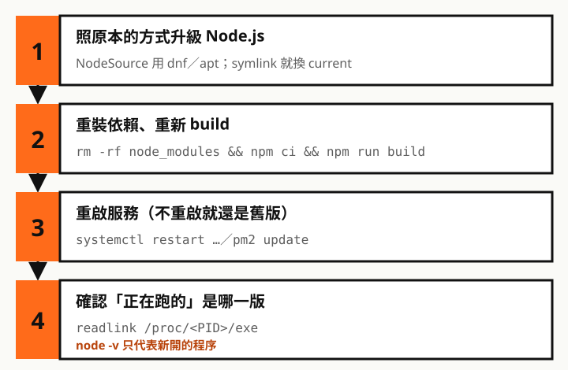

在 Linux 主機上跑 Next.js，Node.js 遲早要升級。我原本以為每台主機的升級方式都一樣，實際更新不同站點時才發現：每台的系統不同、套件管理不同，結果一套一套重新學，多花了不少時間。

同樣是「升級 Node」，做法取決於**當初是怎麼裝的**。最常見的兩種是 **NodeSource 套件庫**和**官方壓縮檔 + symlink**，兩者的檔案位置、升級和回滾方式都不一樣。

> 撰文時（2026 年 10 月），Node.js 20 已經停止支援，Next.js 16 至少要 20.9，所以實際上要用 22 以上，建議 24 或 26。
>
> 對 Rocky Linux 本身還不熟的話，可以先看系列第二篇：[Rocky Linux 基礎篇](/any/articles/rocky-linux-basics/)。

## 先查清楚 Node 是怎麼裝的

```bash
readlink -f "$(command -v node)"                  # 追到實際的執行檔
rpm -qf "$(readlink -f "$(command -v node)")"     # Rocky：屬於哪個套件
dpkg -S "$(readlink -f "$(command -v node)")"     # Ubuntu：屬於哪個套件
```

| 看到的結果 | 安裝方式 |
| --- | --- |
| 在 `/usr/bin`，屬於 `nodejs` 套件，版本含 `nodesource` | NodeSource |
| 在 `/usr/bin`，屬於 `nodejs` 套件，版本含 `el9`、`el10` | Rocky 內建的 AppStream |
| 在 `/opt/…`，「不屬於任何套件」 | 官方壓縮檔 + symlink |

再跑一次 `type -a node`。列出不只一個，代表裝了兩份，要先決定留哪一個。

## /usr/bin 和 /opt 差在哪

> 沒有 `/usr/opt` 這個慣例路徑，平常說的「裝在 opt」指的是根目錄下的 `/opt`。

| 位置 | 誰管理 | 放什麼 |
| --- | --- | --- |
| `/usr/bin` | 套件管理員（dnf、apt） | 套件裝進來的程式，不要手動放檔案 |
| `/usr/local/bin` | 系統管理員自己 | 手動安裝的程式，套件管理員不會動 |
| `/opt` | 系統管理員自己 | 自成一包的軟體，整個資料夾放一起 |


**不要把手動下載的 node 放進或連結到 `/usr/bin`**。那是套件管理員的地盤，之後裝套件時可能被覆蓋或互相衝突。

兩份同時存在時，用哪一份取決於 `PATH` 順序。而 systemd、cron 的 PATH 不一定和登入時一樣，就會出現「我打 `node -v` 是 26，服務跑的是 22」。

## 方法一：NodeSource 套件庫

NodeSource 每個主版本是一個獨立的套件庫，設定腳本名稱就是版本：`setup_24.x`、`setup_26.x`。

**小版本更新**跟一般套件一樣：

```bash
sudo dnf upgrade -y nodejs                        # Rocky
sudo apt update && sudo apt install -y nodejs     # Ubuntu
```

**換主版本**要先換套件庫，否則怎麼升級都只會停在原本的主版本：

```bash
# Rocky
curl -fsSL https://rpm.nodesource.com/setup_26.x -o nodesource_setup.sh
sudo bash nodesource_setup.sh
sudo dnf upgrade -y nodejs

# Ubuntu
curl -fsSL https://deb.nodesource.com/setup_26.x -o nodesource_setup.sh
sudo -E bash nodesource_setup.sh
sudo apt install -y nodejs
```

讀過設定腳本的原始碼，兩點值得知道：

- 腳本會先**刪掉舊的 NodeSource 套件庫設定**，再寫入新版本的，不會兩個主版本並存
- Rocky 上的套件庫優先權高於系統內建的 AppStream，也不受 dnf 模組限制，**不需要先停用 nodejs 模組**

## 方法二：官方壓縮檔 + symlink

從 nodejs.org 下載官方壓縮檔，解壓到 `/opt`，再用 symlink 決定「現在用哪一版」。這一節的做法在 Linux 上實際跑過：用兩個版本的官方執行檔排成壓縮檔的目錄結構，測試切換、回滾和全域套件。

### 安裝與升級

```bash
V=26.12.1                                         # 換成要裝的版本
cd /tmp
curl -fsSLO https://nodejs.org/dist/v$V/node-v$V-linux-x64.tar.xz
curl -fsSLO https://nodejs.org/dist/v$V/SHASUMS256.txt
sha256sum --ignore-missing -c SHASUMS256.txt      # 確認檔案沒被竄改，要看到 OK

sudo mkdir -p /opt/nodejs
sudo tar -xJf node-v$V-linux-x64.tar.xz -C /opt/nodejs

# 讓 current 指向這一版
cd /opt/nodejs
sudo ln -s node-v$V-linux-x64 current.tmp && sudo mv -T current.tmp current

# 只有第一次需要：把 node、npm、npx 接到 /usr/local/bin
for b in node npm npx; do sudo ln -sfn /opt/nodejs/current/bin/$b /usr/local/bin/$b; done
```

完成後的結構：

```text
/usr/local/bin/node -> /opt/nodejs/current/bin/node
/opt/nodejs/current -> node-v26.12.1-linux-x64
```

**升級**就是重複一次下載、解壓、換 `current`；**回滾**只要把 `current` 指回舊版：

```bash
cd /opt/nodejs
sudo ln -s node-v24.22.1-linux-x64 current.tmp && sudo mv -T current.tmp current
```

為什麼不直接用 `ln -sfn` 改 `current`？它是「先刪掉、再建立」，中間有一瞬間 `current` 不存在。先建一個暫時的 symlink，再用 `mv -T` 蓋過去，一步完成，沒有空窗。

舊版資料夾先留著，確認新版沒問題再刪。

### 坑：全域套件不會跟著升級

<div class="callout" role="note">
  <p class="callout-label"><span aria-hidden="true">⚠</span> 重點</p>
  <p><strong>npm 全域套件裝在「版本資料夾」裡，不在 <code>current</code>。</strong>切換版本前先記下清單，切換後重裝。</p>
</div>

| 實測動作 | 結果 |
| --- | --- |
| `npm prefix -g` | `/opt/nodejs/node-v24.22.1-linux-x64`，是實際的版本資料夾 |
| 在 24 版 `npm i -g` 一個工具 | 裝進 `node-v24…/bin/` |
| `current` 切到 26 版 | 26 版資料夾裡沒有這個工具，等於消失 |

```bash
npm ls -g --depth=0        # 切換前：記下全域套件，例如 pm2
sudo npm i -g pm2          # 切換後：重新安裝
```

## 兩種方式怎麼選

| 項目 | NodeSource | 官方壓縮檔 + symlink |
| --- | --- | --- |
| 執行檔位置 | `/usr/bin` | `/opt/nodejs/…`，捷徑在 `/usr/local/bin` |
| 誰管理 | dnf／apt | 自己 |
| 換主版本 | 換套件庫再升級 | 解壓新版、換 `current` |
| 回滾 | 麻煩 | 換回 `current`，幾秒鐘 |
| 多版本並存 | 不行 | 可以 |
| 安全性更新 | 跟著系統一起 `dnf upgrade` | 要自己追 |

- **想省事、讓系統更新一起顧好**：NodeSource
- **要精準控制版本、能快速回滾，或伺服器不能連第三方套件庫**：symlink

Rocky 也可以直接用系統內建的 AppStream 套件，但版本比較保守，最新的 LTS 通常要等一段時間才會進來。

## 升級後，Next.js 要做的事



```bash
rm -rf node_modules
npm ci
npm run build
```

Node 主版本不同，原生模組的編譯結果可能不相容，`node_modules` 整個重裝最保險。

<div class="callout" role="note">
  <p class="callout-label"><span aria-hidden="true">⚠</span> 重點</p>
  <p><strong>已經在跑的程序，不重啟就一直是舊版。</strong>實測先用 24 版啟動程序，再把 <code>current</code> 切到 26：<code>node -v</code> 顯示 v26，但那個程序仍然在用 24 版的 node。</p>
</div>

```bash
sudo systemctl restart my-next-app      # systemd

pm2 update                              # PM2：讓 PM2 本身也換成新版
pm2 unstartup                           # 移除舊的開機啟動設定
pm2 startup                             # 重新產生；照它印出的指令用 sudo 執行
```

最後確認服務實際用的版本。`next start` 啟動後，真正的伺服器程序會改名成 `next-server (v16.x.x)`，所以用這個名字找：

```bash
readlink /proc/$(pgrep -f '^next-server')/exe
```

symlink 安裝會直接顯示版本資料夾的完整路徑，一眼就能看出是不是新版。

> 一句話記住：先查怎麼裝的、照原方式升級，升級完重裝依賴、重新 build、重啟服務。
