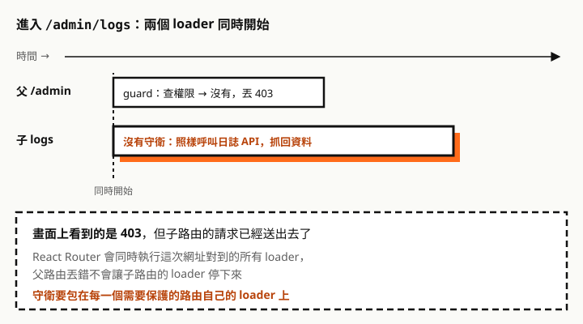

這是〈[React Router v6 權限守衛設計（上）](/any/articles/react-router-v6-permission-guard/)〉的下篇。上篇設計了共用的部分：位元判斷 `can()`、只呼叫一次的 `loadPermissions()`、把權限要求標在路由設定的 `handle.permission`，以及 `<Can>` 元件，並示範 `<BrowserRouter>` 專案怎麼守衛頁面。

這篇講用 `createBrowserRouter` 的專案。頁面守衛可以放在 loader，在畫面渲染**之前**就擋下來，體驗更好；但 loader 的執行方式跟元件不同，照著上篇的直覺做，會踩到幾個坑。

所有程式碼都在 **React Router 6.30.6 + React 19.3** 上用 Vitest 和 Testing Library 實測過；v7 的部分在 React Router 7.18.5 上測試。

## data router 是什麼

React Router 6.4 起多了 **data router**：路由除了決定顯示哪個元件，還能載入資料、處理表單。分辨方式是看專案怎麼建立路由：

| 項目 | 非 data router | data router |
| --- | --- | --- |
| 建立方式 | `<BrowserRouter>` ＋ `<Routes>` 或 `useRoutes()` | `createBrowserRouter()` ＋ `<RouterProvider>` |
| 路由定義在哪 | 元件樹裡面 | 元件樹外面，啟動時固定 |
| 資料什麼時候載入 | 元件渲染後，在 `useEffect` 裡抓 | 換頁時、渲染前，由 `loader` 載入 |
| 權限守衛在哪擋 | 渲染時，會先看到載入中 | 渲染前，頁面完全不出現 |
| 表單送出 | 自己呼叫 API | 可以交給 `action` |
| 守衛的坑 | 很少 | 較多：loader 平行執行、`lazy`、`action` |

有一批 API 只有 data router 能用。實測在 `<MemoryRouter>` 底下呼叫 `useLoaderData`、`useRouteLoaderData`、`useNavigation`、`useMatches`、`useFetcher`、`useBlocker`，全部丟錯「must be used within a data router」；`useNavigate`、`useLocation`、`useParams` 兩邊都能用。

怎麼選：

- **新專案**選 data router。官方文件寫明建議所有 web 專案使用 `createBrowserRouter`。
- **既有專案用 `<BrowserRouter>` 而且運作良好**，不必為了守衛去換，用[上篇](/any/articles/react-router-v6-permission-guard/)的寫法就好。資料已經交給 React Query、SWR 管理的專案也是。
- 需要渲染前就擋權限、`errorElement`、`action`，或離開頁面前確認的 `useBlocker`，才值得換成 data router。

## 坑：守衛放在父路由，擋不住子路由



官方文件寫明，換頁時「下一組對到的路由，它們的 loader 會**同時（in parallel）**被呼叫」。實測守衛只放在父路由 `/admin`、子路由 `logs` 的 loader 沒有守衛：畫面確實顯示 403，但子路由的 loader 已經執行了。這跟上篇的 `<BrowserRouter>` 剛好相反：那裡子頁面要經過父層的 `<Outlet />` 才渲染，父層擋住就夠了。

## 解法：每個路由帶著祖先的要求自己檢查

上篇的 `withGuards()` 只把守衛包在有標記的路由上。在 data router 裡要做更多事：**讓每個路由帶著祖先的要求，自己檢查**。


```ts
// with-guards.ts
import {
  redirect,
  type ActionFunction, type LoaderFunction, type LoaderFunctionArgs, type RouteObject,
} from 'react-router-dom'
import { can, type UnitId } from './permission'
import { loadPermissions, UnauthorizedError } from './permission-store'

export type Requirement = { unit: UnitId; need: number }

async function check(reqs: Requirement[], request: Request) {
  let perms
  try {
    perms = await loadPermissions()
  } catch (e) {
    if (e instanceof UnauthorizedError) {
      const url = new URL(request.url)
      throw redirect(`/login?redirect=${encodeURIComponent(url.pathname + url.search)}`)
    }
    throw e
  }
  if (!reqs.every((r) => can(perms, r.unit, r.need))) {
    throw new Response('Forbidden', { status: 403 })
  }
}

// 先檢查，通過了才執行原本的 loader 或 action
const wrap = <F extends LoaderFunction | ActionFunction>(reqs: Requirement[], fn?: F) =>
  (async (args: LoaderFunctionArgs) => {
    await check(reqs, args.request)
    return fn ? (fn as LoaderFunction)(args) : null
  }) as unknown as F

const fnOf = <T,>(v: unknown) => (typeof v === 'function' ? (v as T) : undefined)

export function withGuards(routes: RouteObject[], inherited: Requirement[] = []): RouteObject[] {
  return routes.map((route) => {
    const own = route.handle?.permission as Requirement | undefined
    const ownAction = route.handle?.actionPermission as Requirement | undefined
    const reqs = own ? [...inherited, own] : inherited          // 祖先的 + 自己的
    const actionReqs = ownAction ? [...reqs, ownAction] : reqs  // 送出表單可以要求更高
    const loader = fnOf<LoaderFunction>(route.loader)
    const action = fnOf<ActionFunction>(route.action)
    const next: Record<string, unknown> = { ...route }

    if (reqs.length > 0) {
      if (route.lazy) {
        // lazy 路由：包住載入回來的 loader、action（原因見下方表格）
        const lazy = route.lazy
        delete next.loader
        delete next.action
        next.lazy = async () => {
          const m = await lazy()
          return {
            ...m,
            loader: wrap(reqs, fnOf<LoaderFunction>(m.loader)),
            ...(m.action ? { action: wrap(actionReqs, fnOf<ActionFunction>(m.action)) } : {}),
          }
        }
      } else {
        // 自己有 loader 或自己有標記，才加守衛
        if (loader || own) next.loader = wrap(reqs, loader)
        if (action) next.action = wrap(actionReqs, action)
      }
    }
    if (route.children) next.children = withGuards(route.children, reqs)
    return next as RouteObject
  })
}
```

路由設定：

```tsx
// router.tsx
export const router = createBrowserRouter(withGuards([
  {
    id: 'root',
    path: '/',
    loader: () => loadPermissions().catch(() => new Map()), // 給 <Can> 用
    element: <Layout />,
    errorElement: <RouteError />,
    children: [
      {
        // 沒有 path 的路由：只用來標記權限和顯示 403，版面不會被蓋掉
        handle: { permission: { unit: Unit.Orders, need: Perm.Read } },
        errorElement: <RouteError />,
        children: [
          { path: 'orders', loader: ordersLoader, element: <OrdersPage /> },
          {
            path: 'orders/:id',
            handle: { actionPermission: { unit: Unit.Orders, need: Perm.Update } },
            loader: orderLoader,
            action: saveOrder, // 要有 Update 才會執行
            element: <OrderPage />,
          },
        ],
      },
      {
        handle: { permission: { unit: Unit.Reports, need: Perm.Read } },
        errorElement: <RouteError />,
        children: [{ path: 'reports', lazy: () => import('./pages/reports') }],
      },
      { path: 'login', element: <LoginPage /> },
    ],
  },
]))
```

403 由 `errorElement` 顯示。上篇的 `<Can>` 只要把 `usePermissions()` 換成讀 root 路由的 loader，程式和用法都不用改：

```tsx
// RouteError.tsx
import { isRouteErrorResponse, useRouteError } from 'react-router-dom'

export function RouteError() {
  const error = useRouteError()
  if (isRouteErrorResponse(error) && error.status === 403) {
    return <h1>沒有權限檢視這個頁面</h1>
  }
  return <h1>發生錯誤</h1>
}

// 給 <Can> 用
import { useRouteLoaderData } from 'react-router-dom'
export function usePermissions(): Permissions {
  return useRouteLoaderData('root') as Permissions
}
```

把上面這份路由設定原樣搬去測（使用者的訂單權限是 5 或 1，沒有報表權限）：

| 情境 | 結果 |
| --- | --- |
| 訂單 5，進 `/orders` | 進得去，選單只出現「訂單管理」 |
| 進 `/reports` | 403 顯示在版面內，選單還在；**lazy 的 loader 沒執行** |
| 訂單 1（只有 Read），在 `/orders/7` 送出表單 | 403，`saveOrder` 沒執行 |
| 訂單 5（Read + Update），在 `/orders/7` 送出表單 | `saveOrder` 執行 |
| 權限 API 回 401 | 導到登入頁，資料 loader 沒執行 |

## `withGuards()` 為什麼寫成這樣

第一版的 `withGuards()` 只做一件事：把守衛 loader 加到每個子孫路由。實測後發現四個副作用，上面的版本是修正過的：

| 第一版的問題 | 實測看到什麼 | 修正 |
| --- | --- | --- |
| lazy 路由的 loader 被吃掉 | 路由先有了靜態 loader，`lazy()` 回傳的 loader 被忽略，console 出現警告，頁面資料沒載入 | lazy 路由不加靜態 loader，改成包住 `lazy()` 載入回來的結果 |
| action 沒有守衛 | 完全沒權限的人送出表單，action 照樣執行 | action 也包上守衛，並支援 `handle.actionPermission` |
| 403 蓋掉整個版面 | 權限標在有版面的路由上，403 取代整個版面，側欄消失 | 權限標在版面底下「沒有 path 的路由」，403 顯示在版面內 |
| 換頁多一段 loading | 原本沒有 loader 的頁面，`navigation.state` 會先變 `loading`，全域載入條閃一下 | 只在自己有 loader 或自己有標記的路由加守衛 |

修不掉的有一個：自己有標記、卻沒有 loader 的路由，進入時還是會經過一次 `loading`，因為守衛本身就是 loader。權限已經載入過的話，只是一瞬間。

## 換人登入時更新權限

data router 的權限在兩個地方：`loadPermissions()` 的快取，以及 root 路由 loader 回傳的資料。實測只清快取再換頁，`<Can>` 還在用上一個人的權限。

清掉快取後呼叫 `router.revalidate()`，所有目前畫面上的 loader 會重新執行，`<Can>` 跟著更新，實測有效：

```ts
async function logout() {
  await fetch('/api/logout', { method: 'POST', credentials: 'include' })
  resetPermissions()
  await router.navigate('/login')
  router.revalidate()
}
```

想要最保險，也可以跟上篇一樣用 `window.location.assign()` 重新載入頁面。登入後跳回原網址時，記得用上篇的 `safeRedirect()` 擋掉外部網址。

## 升級到 v7：middleware

React Router v7 加了 `middleware`，正是為了這個問題。官方文件說明 middleware 會**由父到子依序執行，全部完成後才執行 loader**，並直接寫出這個坑：loader 是平行執行的，父路由的 loader 保護不了子路由的 loader。

```tsx
// React Router v7（套件是 react-router）
{
  path: 'admin',
  middleware: [requirePermission(Unit.Reports, Perm.Read)], // 丟出 403 或 redirect 就停下
  children: [{ path: 'logs', loader: logsLoader, Component: LogsPage }],
}
```

我在 React Router 7.18.5 的 data router 上測過：父路由的 middleware 丟出 403，子路由的 loader 就不會執行，不開 `v8_middleware` 旗標也一樣。將來升級時，把 `handle.permission` 換成 `middleware` 即可。

## 前端守衛擋不住的事

<div class="callout" role="note">
  <p class="callout-label"><span aria-hidden="true">⚠</span> 重點</p>
  <p><strong>loader 和 action 的守衛還是在瀏覽器裡執行</strong>。使用者可以略過它直接呼叫 API，每一支 API 都必須用伺服器上的權限資料自己檢查。</p>
</div>

## 這次實測了什麼

在 React Router 6.30.6、React 19.3.1、Vitest 3.2.7（jsdom）上：

- 守衛只放父路由時，子路由 loader 照樣執行
- `withGuards()`：要求自動繼承、孫路由疊加、沒標記的路由不受影響、401 導向登入
- `withGuards()` 第一版的四個副作用，以及修正後的結果
- 文中的路由設定原樣測試，包含 lazy、action、版面保留、選單、401
- 換人登入後只清快取會沿用舊權限，`router.revalidate()` 可以更新
- 哪些 hook 在非 data router 會丟錯
- React Router 7.18.5：父路由 middleware 丟出 403，子路由 loader 不執行

沒有測的：

- 真實瀏覽器（測試跑在 jsdom）
- `useFetcher` 呼叫受保護路由的 loader、action
- v7 的其他部分：套件名稱和部分 API 有調整，升級時要對照官方文件

## 一句話複習

data router 的 loader 在渲染前執行，但**同一次換頁的 loader 是同時執行的**，父路由擋不住子路由。用 `withGuards()` 讓每個路由帶著祖先的要求自己檢查，lazy、action、版面各有處理方式；升級到 v7 就改用 middleware。

參考資料：[React Router v6：Picking a Router](https://reactrouter.com/6.26.1/routers/picking-a-router)、[React Router v6：loader](https://reactrouter.com/v6/route/loader)、[React Router：Middleware](https://reactrouter.com/how-to/middleware)。
