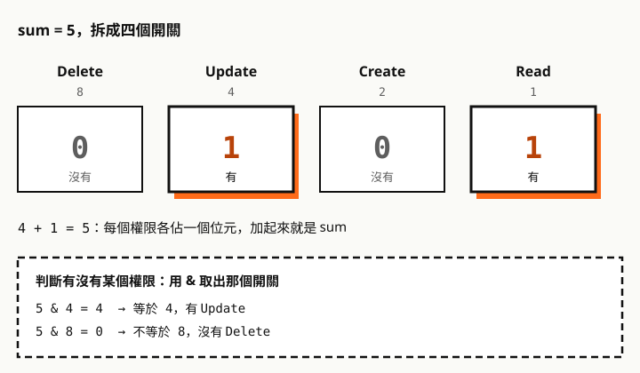
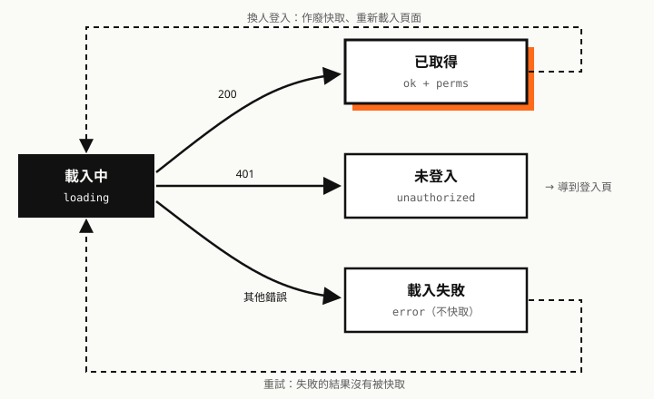
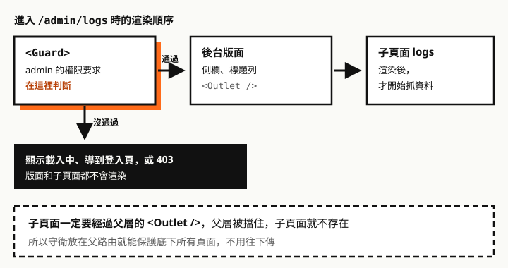

後台系統的權限守衛，常見的寫法是在每個頁面、每個按鈕各自判斷。功能少的時候沒問題，功能一多就會出現：選單看得到但點進去是 403、按鈕藏了但網址直接打得進去、權限規則改了只改到一半。

這篇把權限守衛當成一個小系統來設計：先列需求，再拆架構、定義狀態，最後逐一說明設計決策的理由與取捨。程式碼放在最後當參考實作。

這是上下兩篇的上篇：

- **上篇（這篇）**：系統設計，以及 `<BrowserRouter>` 專案的參考實作。
- **下篇**：〈[data router 的 loader 守衛與它的坑](/any/articles/react-router-v6-data-router-guard/)〉。用 `createBrowserRouter` 的專案，架構不變，只換最上面的套用層，但有幾個非知道不可的坑。

參考實作在 **React Router 6.30.6 + React 19.3** 上用 Vitest 與 Testing Library 實測過。

## 需求

**輸入**：登入後，權限 API 回傳目前使用者在每個單元的權限：

```json
[
  { "id": 101, "unitName": "訂單管理", "sum": 5 },
  { "id": 102, "unitName": "會員管理", "sum": 1 }
]
```

`sum` 是四種權限的位元和：Read 1、Create 2、Update 4、Delete 8。文中的單元與代號都是虛構範例。

| 類型 | 需求 |
| --- | --- |
| 功能 | 沒有讀取權限的頁面，網址直接輸入也進不去 |
| 功能 | 頁面裡的按鈕、欄位依權限顯示 |
| 功能 | 選單只列出進得去的頁面 |
| 功能 | 沒登入導到登入頁，登入後回到原頁 |
| 非功能 | 權限 API 不要每次換頁都呼叫 |
| 非功能 | 權限規則只寫一處，路由、選單、按鈕不會不一致 |
| 非功能 | 換人登入不能沿用上一個人的權限 |
| 非功能 | 換路由寫法（升級到 data router）時，改動越少越好 |
| 限制 | 前端無法保證安全，授權必須由 API 執行 |

## 權限模型



前端把 API 的陣列轉成「單元 id → sum」的對照表，判斷規則只有一條：

```ts
can(perms, unit, need) = (sum & need) === need
```

- **API 沒列出的單元，視為沒有任何權限**（sum 當成 0）。
- `need` 可以組合，`Perm.Read | Perm.Update` 表示兩個都要有。

## 架構：五層


| 層 | 模組 | 負責 | 不負責 |
| --- | --- | --- | --- |
| ① 資料來源 | 權限 API | 回傳權限、**執行真正的授權** | 畫面 |
| ② 權限服務 | `permission-store.ts` | 只載入一次、分類錯誤、作廢快取 | 判斷權限 |
| ③ 判斷核心 | `permission.ts` | 權限種類、單元代號、`can()` | 知道 React 或路由 |
| ④ 權限宣告 | `access.ts` | 每個功能需要什麼權限 | 怎麼判斷、怎麼顯示 |
| ⑤ 套用 | `<Guard>`、`<Can>`、`<Nav>` | 依狀態決定畫面 | 權限規則本身 |

分層的依據是**每一層變動的原因不同**：

- 權限規則（哪個功能要什麼權限）最常改，只動 ④。
- 判斷邏輯幾乎不變，③ 是純函式，用一般的單元測試就能涵蓋。
- 路由寫法只有升級時才變，只動 ⑤。下篇的 data router 版本，①～④ 完全沿用。

依賴方向只能往下：③ 不能 import React，④ 不能 import 元件。這條規則保證判斷核心可以單獨測試，也能拿到別的專案或後端（Node.js）重用。

## 權限的四種狀態

權限是非同步載入的，所以任何時刻都處在四種狀態之一：



三種守衛對每種狀態都要有明確反應，不能有「沒想到的狀態」：

| 狀態 | `<Guard>`（頁面） | `<Can>`（按鈕） | `<Nav>`（選單） |
| --- | --- | --- | --- |
| 載入中 | 顯示載入中，不渲染頁面 | 不顯示 | 空的 |
| 已取得，有權限 | 放行 | 顯示 | 列出 |
| 已取得，沒權限 | 顯示 403，保留版面 | 不顯示，或顯示 `fallback` | 不列出 |
| 未登入（401） | 導到登入頁，帶回原網址 | 不顯示 | 空的 |
| 載入失敗 | 顯示錯誤，可重試 | 不顯示 | 空的 |

共同原則是**不確定就當作沒有權限**（fail closed）。載入中的 `<Can>` 不顯示按鈕，比先顯示再收回好：使用者不會看到一閃而過、按了卻失敗的按鈕。實測權限 API 延遲回應時，選單是空的、按鈕沒有出現，載入完成後才依權限顯示；API 回 500 時，頁面顯示「權限載入失敗」。

## 設計決策

### D1：用單元 id 對應，不用名稱

**決策**：判斷權限用 API 的 `id`，`unitName` 只拿來顯示。前端用常數 `Unit.Orders = 101` 對應。

**理由**：名稱是給人看的，可能改字、改語言；代號是給程式用的，不會變。

**取捨**：前端要維護一份代號常數，後端新增單元時要同步。

### D2：判斷集中成一個純函式

**決策**：全站只有 `can()` 一個地方做位元運算，寫成 `(sum & need) === need`。

**理由**：位元運算容易寫錯。寫成 `> 0` 的話，`need` 是 Read 加 Delete（9）、`sum` 是 5 時，`5 & 9` 等於 1，會誤判成有權限。集中在一處，寫對一次、測一次就好。

**取捨**：位元權限最多 31 種。JavaScript 的位元運算以 32 位元有號整數計算，實測第 31 個位元（值 2147483648）做 AND 會得到負數，判斷失敗。目前四種遠低於上限；真的不夠時，要改用陣列或字串表示權限。

### D3：權限只載入一次，失敗不快取

**決策**：把 API 請求存成一個 Promise，全站共用；失敗時清掉，下次重試。

**理由**：權限在一次登入期間幾乎不變，每次換頁都問 API 是浪費。實測換頁多次，權限 API 只呼叫一次。

**取捨**：管理者在使用期間調整權限，前端不會馬上知道。這由 D9 處理：API 照樣會擋，前端收到 403 時再重新載入權限。

### D4：權限規則宣告在一處

**決策**：建一個權限宣告表 `access.ts`，路由、選單、按鈕都引用它，不各自寫 `{ unit, need }`。

```ts
// access.ts：哪個功能需要什麼權限，只寫在這裡
export const ACCESS = {
  orders:      { unit: Unit.Orders,  need: Perm.Read },
  orderCreate: { unit: Unit.Orders,  need: Perm.Create },
  orderDelete: { unit: Unit.Orders,  need: Perm.Delete },
  reports:     { unit: Unit.Reports, need: Perm.Read },
} as const

// 路由
{ path: 'orders', handle: { permission: ACCESS.orders }, element: <OrdersPage /> }
// 選單
{ to: '/orders', label: '訂單管理', access: ACCESS.orders }
// 按鈕
<Can {...ACCESS.orderCreate}><button>新增</button></Can>
```

**理由**：需求裡的「選單看得到、點進去 403」，原因幾乎都是路由和選單各寫一份、改了一份。共用同一個常數，就不會發生。實測選單和路由引用同一份宣告時，選單只列出進得去的頁面。

**取捨**：多一層間接。小專案只有幾個頁面時，可以先省略，直接寫在路由設定上。

### D5：頁面守衛放在版面層，子頁面繼承

**決策**：權限標在路由設定的 `handle.permission`，由 `withGuards()` 自動用 `<Guard>` 包住該路由的 element。標在父路由，就保護底下所有子頁面。



**理由**：在 `<BrowserRouter>` 裡，子頁面要經過父層的 `<Outlet />` 才會渲染。父層被擋住，子頁面根本不存在，它在 `useEffect` 裡的資料請求也不會發出。實測沒權限時子頁面沒有渲染、也沒有抓資料；子路由另外標了更高的要求時，兩層都要通過。

**取捨**：這個「父層擋住就夠」的性質，**在 data router 不成立**，因為 data router 的 loader 是同時執行的。這是下篇的主題。

### D6：沒權限時，頁面顯示 403，元件直接隱藏

**決策**：

- 頁面：顯示 403，而且顯示在版面裡面，側欄還在，使用者能點去別處。
- 按鈕、欄位：直接不渲染，需要時用 `fallback` 說明原因。
- 選單：不列出。

**理由**：disabled 的按鈕還是看得到，使用者會一直想點，卻不知道為什麼不能用。頁面不用隱藏而顯示 403，是因為使用者是透過網址進來的，什麼都不顯示會以為網站壞了。

**取捨**：使用者不知道系統有哪些自己用不到的功能。要讓他知道功能存在（例如引導申請權限），就用 `fallback` 顯示說明。

### D7：區分 401 和 403，登入後的跳轉只接受站內路徑

**決策**：401（沒登入）導到登入頁，網址帶 `redirect` 參數；403（沒權限）顯示 403 頁。登入後跳轉前，用 `safeRedirect()` 檢查參數。

**理由**：兩者的處理方式完全不同，沒登入要去登入，沒權限登入也沒用。`redirect` 參數來自網址、任何人都能改，只檢查「開頭是 `/`」不夠：實測瀏覽器會把 `//evil.example/x` 和 `/\evil.example/x` 都解析成外部網站 `evil.example`，不擋就會被拿來把使用者導到釣魚頁。

**取捨**：沒有。這是一定要做的。

### D8：換人登入時重新載入頁面

**決策**：登入、登出成功後，用 `window.location.assign()` 重新載入頁面。

**理由**：權限留在兩個地方：權限服務的快取，以及畫面上 Context 手上的那一份。實測只清快取再換頁，`<Can>` 還在用上一個人的權限，原本看得到的「刪除」照樣顯示。重新載入一次把記憶體全部清掉，不用逐一追蹤哪裡還留著舊資料。

**取捨**：多一次整頁載入。登入登出不常發生，這個成本可以接受。不想重新載入的話，要讓 `PermissionProvider` 提供重新載入的方法（data router 可以用 `router.revalidate()`，見下篇）。

### D9：授權由 API 執行，前端只負責體驗

<div class="callout" role="note">
  <p class="callout-label"><span aria-hidden="true">⚠</span> 重點</p>
  <p><strong>前端守衛的目標是讓使用者不會看到、點到自己不能用的東西，不是安全</strong>。使用者打開開發者工具、改掉 JavaScript，或直接呼叫 API，都能繞過前端守衛。每一支 API 都必須用伺服器上的權限資料自己檢查。</p>
</div>

API 回 403 時，代表前端的權限可能過時了（D3 的取捨），可以作廢快取並重新載入權限，讓畫面跟著更新。

更多前端資安主題，請看[資安專題](/any/security/)。

## 擴充時要改哪裡

| 情境 | 要改的地方 |
| --- | --- |
| 新增一個單元 | ③ 加單元代號；④ 加宣告；路由、選單引用宣告 |
| 新增一種權限（例如匯出 16） | ③ 加 `Perm.Export = 16`，最多到第 30 個位元 |
| 權限規則調整 | 只改 ④ |
| 改用 data router | 只改 ⑤，見下篇 |
| 權限要即時更新 | ② 加作廢與重新載入的方法，⑤ 在 API 回 403 時呼叫 |

## 參考實作

以下是 `<BrowserRouter>` 專案的完整實作，依架構分檔。

### ③ 判斷核心：`permission.ts`

```ts
export const Perm = { Read: 1, Create: 2, Update: 4, Delete: 8 } as const

// 單元代號（虛構範例），對應 API 的 id
export const Unit = { Orders: 101, Members: 102, Reports: 103 } as const
export type UnitId = (typeof Unit)[keyof typeof Unit]

export type PermissionRow = { id: number; unitName: string; sum: number }
export type Permissions = ReadonlyMap<number, number> // 單元 id → sum
export type Requirement = { unit: UnitId; need: number }

export const toPermissions = (rows: PermissionRow[]): Permissions =>
  new Map(rows.map((r) => [r.id, r.sum]))

/** need 可以組合：Perm.Read | Perm.Update 表示兩個都要有 */
export function can(perms: Permissions, unit: UnitId, need: number): boolean {
  const sum = perms.get(unit) ?? 0
  return (sum & need) === need
}
```

### ② 權限服務：`permission-store.ts`

```ts
import { toPermissions, type Permissions, type PermissionRow } from './permission'

export class UnauthorizedError extends Error {}

let pending: Promise<Permissions> | null = null

export function loadPermissions(): Promise<Permissions> {
  pending ??= (async () => {
    const res = await fetch('/api/permissions', { credentials: 'include' })
    if (res.status === 401) throw new UnauthorizedError()
    if (!res.ok) throw new Error(`權限 API 失敗：${res.status}`)
    return toPermissions((await res.json()) as PermissionRow[])
  })().catch((e) => {
    pending = null // 失敗不要快取，下次再試
    throw e
  })
  return pending
}

export function resetPermissions() {
  pending = null
}
```

### ⑤ 套用：`permission-react.tsx`

```tsx
import { createContext, useContext, useEffect, useState, type ReactNode } from 'react'
import { Navigate, useLocation, type RouteObject } from 'react-router-dom'
import { can, type Permissions, type Requirement, type UnitId } from './permission'
import { loadPermissions, UnauthorizedError } from './permission-store'

// 四種狀態
type State =
  | { status: 'loading' }
  | { status: 'ok'; perms: Permissions }
  | { status: 'unauthorized' }
  | { status: 'error' }
const Ctx = createContext<State>({ status: 'loading' })

export function PermissionProvider({ children }: { children: ReactNode }) {
  const [state, setState] = useState<State>({ status: 'loading' })
  useEffect(() => {
    let alive = true
    loadPermissions().then(
      (perms) => alive && setState({ status: 'ok', perms }),
      (e) => alive && setState({ status: e instanceof UnauthorizedError ? 'unauthorized' : 'error' }),
    )
    return () => { alive = false }
  }, [])
  return <Ctx.Provider value={state}>{children}</Ctx.Provider>
}

/** 頁面守衛 */
export function Guard({ req, children }: { req: Requirement; children: ReactNode }) {
  const state = useContext(Ctx)
  const location = useLocation()
  if (state.status === 'loading') return <p>載入中…</p>
  if (state.status === 'error') return <h1>權限載入失敗</h1>
  if (state.status === 'unauthorized') {
    const back = encodeURIComponent(location.pathname + location.search)
    return <Navigate to={`/login?redirect=${back}`} replace />
  }
  if (!can(state.perms, req.unit, req.need)) return <h1>沒有權限檢視這個頁面</h1>
  return children
}

/** 不確定就當作沒有權限：還沒載入完成時回傳空的對照表 */
const EMPTY: Permissions = new Map()
export function usePermissions(): Permissions {
  const state = useContext(Ctx)
  return state.status === 'ok' ? state.perms : EMPTY
}

/** 元件守衛 */
export function useCan(unit: UnitId, need: number): boolean {
  return can(usePermissions(), unit, need)
}
export function Can({ unit, need, children, fallback = null }: Requirement & { children: ReactNode; fallback?: ReactNode }) {
  return useCan(unit, need) ? children : fallback
}

/** 有標記 handle.permission 的路由，element 自動包上 <Guard> */
export function withGuards(routes: RouteObject[]): RouteObject[] {
  return routes.map((route) => {
    const req = route.handle?.permission as Requirement | undefined
    return {
      ...route,
      ...(req ? { element: <Guard req={req}>{route.element}</Guard> } : {}),
      ...(route.children ? { children: withGuards(route.children) } : {}),
    } as RouteObject
  })
}
```

### 組合起來

```tsx
// routes.tsx
const NAV = [
  { to: '/orders', label: '訂單管理', access: ACCESS.orders },
  { to: '/reports', label: '報表', access: ACCESS.reports },
]

function Nav() {
  const perms = usePermissions()
  const items = NAV.filter((i) => can(perms, i.access.unit, i.access.need))
  return <nav>{items.map((i) => <NavLink key={i.to} to={i.to}>{i.label}</NavLink>)}</nav>
}

const routes: RouteObject[] = [
  {
    path: '/',
    element: <Layout />, // 裡面有 <Nav /> 和 <Outlet />
    children: [
      { path: 'orders', handle: { permission: ACCESS.orders }, element: <OrdersPage /> },
      { path: 'reports', handle: { permission: ACCESS.reports }, element: <ReportsPage /> },
    ],
  },
  { path: '/login', element: <LoginPage /> },
]

const AppRoutes = () => useRoutes(withGuards(routes))

// main.tsx
<BrowserRouter>
  <PermissionProvider>
    <AppRoutes />
  </PermissionProvider>
</BrowserRouter>
```

路由是用 `<Routes>` JSX 寫的話，不經過 `withGuards()`，直接包即可：`<Route path="orders" element={<Guard req={ACCESS.orders}><OrdersPage /></Guard>} />`。

登入、登出與跳轉（D7、D8）：

```ts
/** 登入後要跳回的網址：只接受站內路徑 */
export function safeRedirect(to: string | null, fallback = '/') {
  if (!to || !to.startsWith('/') || to.startsWith('//') || to.startsWith('/\\')) return fallback
  return to
}

async function logout() {
  await fetch('/api/logout', { method: 'POST', credentials: 'include' })
  window.location.assign('/login')
}

// 登入成功後
window.location.assign(safeRedirect(new URLSearchParams(location.search).get('redirect')))
```

## 驗證

在 React Router 6.30.6、React 19.3.1、Vitest 3.2.7（jsdom）上測過：

- `can()` 的位元組合，以及第 31 個位元的上限
- 權限 API 只呼叫一次；失敗（500）時顯示載入失敗
- 四種狀態下 `<Guard>`、`<Can>`、選單的反應
- 子路由要求疊加、沒權限時子頁面不渲染也不抓資料、401 導向登入並帶回原網址
- 選單與路由共用宣告表
- 換人登入只清快取會沿用舊權限
- `safeRedirect()` 擋掉外部網址

沒有測的：真實瀏覽器、不重新載入頁面的權限更新、搭配 `React.lazy` 與 `Suspense`。

## 一句話複習

把權限守衛拆成五層：**API 執行授權、服務管快取與狀態、純函式做判斷、宣告表寫規則、最上層才是畫面**。四種狀態都有明確反應，不確定就當作沒有權限；路由寫法只影響最上層。

用 `createBrowserRouter` 的專案，接著看〈[下篇：data router 的 loader 守衛與它的坑](/any/articles/react-router-v6-data-router-guard/)〉。
