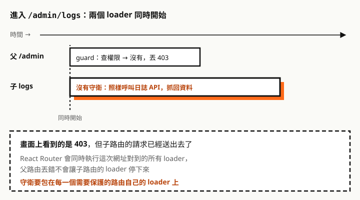

後台系統幾乎都會遇到這兩個需求：

- **進入頁面**：沒有「讀取」權限的人，連網址都不該進得去。
- **元件顯示**：進得去的人，也只看得到自己能用的按鈕，例如有「修改」但沒有「刪除」。

這篇用一個具體的前提來設計：權限從 API 取得，每一筆有 `id`、`unitName`、`sum` 三個欄位，`sum` 用位元表示四種權限。

所有程式碼都在 **React Router 6.30.6 + React 19.3** 上用 Vitest 和 Testing Library 實測過，共 9 個測試全部通過。

## 前提：API 回傳的權限

```json
[
  { "id": 101, "unitName": "訂單管理", "sum": 5 },
  { "id": 102, "unitName": "會員管理", "sum": 1 }
]
```

| 權限 | 值 |
| --- | --- |
| Read（讀取） | 1 |
| Create（新增） | 2 |
| Update（修改） | 4 |
| Delete（刪除） | 8 |

這篇的假設：

- `id` 是單元的代號，**判斷權限用 `id`**，`unitName` 只拿來顯示。名稱可能改，代號不會。
- API 沒有列出的單元，代表完全沒有權限。
- 文中的單元（訂單、會員、報表）和代號都是虛構範例。

## sum 怎麼讀：四個開關


每種權限的值都是 2 的次方，所以各自佔一個位元，互不干擾。`sum` 是有的權限加起來的結果，例如 5 = 4 + 1，就是 Update 加 Read。

判斷有沒有某個權限，用位元 AND（`&`）把那個位元取出來：

```ts
// permission.ts
export const Perm = { Read: 1, Create: 2, Update: 4, Delete: 8 } as const

// 單元代號（虛構範例），對應 API 的 id
export const Unit = { Orders: 101, Members: 102, Reports: 103 } as const
export type UnitId = (typeof Unit)[keyof typeof Unit]

export type PermissionRow = { id: number; unitName: string; sum: number }
export type Permissions = ReadonlyMap<number, number> // 單元 id → sum

export const toPermissions = (rows: PermissionRow[]): Permissions =>
  new Map(rows.map((r) => [r.id, r.sum]))

/** need 可以組合：Perm.Read | Perm.Update 表示兩個都要有 */
export function can(perms: Permissions, unit: UnitId, need: number): boolean {
  const sum = perms.get(unit) ?? 0
  return (sum & need) === need
}
```

以訂單（`sum: 5`）實測：

| 呼叫 | 結果 |
| --- | --- |
| `can(p, Unit.Orders, Perm.Read)` | `true` |
| `can(p, Unit.Orders, Perm.Create)` | `false` |
| `can(p, Unit.Orders, Perm.Update)` | `true` |
| `can(p, Unit.Orders, Perm.Read \| Perm.Update)` | `true`，兩個都有 |
| `can(p, Unit.Orders, Perm.Read \| Perm.Delete)` | `false`，缺 Delete |
| `can(p, Unit.Reports, Perm.Read)` | `false`，API 沒給這個單元 |

判斷寫成 `=== need` 而不是 `> 0`，是為了第五列這種情況：`5 & 9` 等於 1，用 `> 0` 會誤判成有權限。

## 整體設計


這個設計用的是 React Router 6.4 起的 **data router**（`createBrowserRouter` + `RouterProvider`），因為它的 loader 會在畫面渲染**之前**執行，守衛可以在頁面出現前就做決定。還在用 `<BrowserRouter>` 的專案，後面有另一種寫法。

### 權限只要一次

每次換頁都重新呼叫權限 API 太浪費。把請求存成一個 Promise，所有 loader 和元件共用：

```ts
// permission-store.ts
import { toPermissions, type Permissions, type PermissionRow } from './permission'

export class UnauthorizedError extends Error {}

let pending: Promise<Permissions> | null = null

export function loadPermissions(): Promise<Permissions> {
  pending ??= (async () => {
    const res = await fetch('/api/permissions', { credentials: 'include' })
    if (res.status === 401) throw new UnauthorizedError()
    if (!res.ok) throw new Error(`權限 API 失敗：${res.status}`)
    return toPermissions((await res.json()) as PermissionRow[])
  })().catch((e) => {
    pending = null // 失敗不要快取，下次再試
    throw e
  })
  return pending
}

/** 登入、登出、切換角色後呼叫，下次會重新向 API 要 */
export function resetPermissions() {
  pending = null
}
```

實測從訂單頁換到報表頁、再換回訂單頁，權限 API 只被呼叫一次。

## ① 進入頁面的守衛

守衛是一個「包住 loader 的函式」：先檢查權限，通過了才執行頁面原本的 loader。

```ts
// guard.ts
import { redirect, type LoaderFunction, type LoaderFunctionArgs } from 'react-router-dom'
import { can, type UnitId } from './permission'
import { loadPermissions, UnauthorizedError } from './permission-store'

export function guard(unit: UnitId, need: number, loader?: LoaderFunction): LoaderFunction {
  return async (args: LoaderFunctionArgs) => {
    let perms
    try {
      perms = await loadPermissions()
    } catch (e) {
      if (e instanceof UnauthorizedError) {
        const url = new URL(args.request.url)
        throw redirect(`/login?redirect=${encodeURIComponent(url.pathname + url.search)}`)
      }
      throw e
    }
    if (!can(perms, unit, need)) {
      throw new Response('Forbidden', { status: 403 })
    }
    return loader ? loader(args) : null
  }
}
```

路由設定：

```tsx
// router.tsx
const router = createBrowserRouter([
  {
    id: 'root',
    path: '/',
    loader: () => loadPermissions().catch(() => new Map()), // 給 <Can> 用
    element: <Layout />,
    errorElement: <RouteError />,
    children: [
      {
        path: 'orders',
        loader: guard(Unit.Orders, Perm.Read, ordersLoader),
        element: <OrdersPage />,
        errorElement: <RouteError />,
      },
      {
        path: 'orders/new',
        loader: guard(Unit.Orders, Perm.Create),
        element: <NewOrderPage />,
        errorElement: <RouteError />,
      },
      { path: 'login', element: <LoginPage /> },
    ],
  },
])
```

403 由 `errorElement` 顯示：

```tsx
// RouteError.tsx
import { isRouteErrorResponse, useRouteError } from 'react-router-dom'

export function RouteError() {
  const error = useRouteError()
  if (isRouteErrorResponse(error) && error.status === 403) {
    return <h1>沒有權限檢視這個頁面</h1>
  }
  return <h1>發生錯誤</h1>
}
```

每個子路由都放 `errorElement`，403 就會顯示在 `<Layout>` 裡面，導覽列還在，使用者可以點去別的頁面。

實測結果（使用者的權限是訂單 5、會員 1）：

| 情境 | 結果 |
| --- | --- |
| 進 `/orders`，有 Read | 進得去，`ordersLoader` 正常執行 |
| 進 `/orders/new`，沒有 Create | 顯示 403 |
| 進 `/reports`，API 沒給這個單元 | 顯示 403；**頁面元件渲染次數 0、資料 loader 沒有執行** |
| 權限 API 回 401，進 `/orders?page=2` | 導到 `/login?redirect=%2Forders%3Fpage%3D2` |

「頁面元件渲染次數 0」是 loader 守衛最大的好處：沒有權限的頁面一次都不會出現，不會閃一下再跳走，也不會先打出它的資料請求。

### 一定要注意：守衛要放在每個路由上

直覺上會想把守衛放在父路由，一次保護底下所有頁面。在 data router 裡**這樣擋不住**。



React Router 官方文件寫明，換頁時「下一組對到的路由，它們的 loader 會**同時（in parallel）**被呼叫」。實測守衛只放在父路由 `/admin`、子路由 `logs` 的 loader 沒包守衛：畫面確實顯示 403，但子路由的 loader 已經執行了。

<div class="callout" role="note">
  <p class="callout-label"><span aria-hidden="true">⚠</span> 重點</p>
  <p><strong>每一個需要保護的路由，都要用 <code>guard()</code> 包住自己的 loader</strong>。父路由的守衛只能決定畫面顯示 403，擋不住子路由抓資料。</p>
</div>

### 還在用 `<BrowserRouter>`：元件包住 `<Outlet />`

沒有 loader 的專案，守衛只能放在渲染階段：

```tsx
// RequirePermission.tsx
export function RequirePermission({ unit, need }: { unit: UnitId; need: number }) {
  const state = usePermissionState() // 由 PermissionProvider 載入權限
  const location = useLocation()

  if (state.status === 'loading') return <p>載入中…</p>
  if (state.status === 'unauthorized') {
    const back = encodeURIComponent(location.pathname + location.search)
    return <Navigate to={`/login?redirect=${back}`} replace />
  }
  if (!can(state.perms, unit, need)) return <h1>沒有權限檢視這個頁面</h1>
  return <Outlet />
}

// 用法
<Routes>
  <Route element={<RequirePermission unit={Unit.Orders} need={Perm.Read} />}>
    <Route path="/orders" element={<OrdersPage />} />
  </Route>
</Routes>
```

`PermissionProvider` 在 `useEffect` 裡呼叫同一個 `loadPermissions()`，把結果放進 Context。實測先顯示「載入中…」，權限回來後才顯示頁面或 403。

兩種寫法的差別：

| 項目 | loader 守衛（data router） | 元件守衛（`<BrowserRouter>`） |
| --- | --- | --- |
| 什麼時候判斷 | 渲染前 | 渲染時 |
| 沒權限的頁面 | 完全不渲染 | 守衛擋住，`<Outlet />` 不渲染 |
| 載入中的畫面 | 停在上一頁，等判斷完才換頁 | 會先出現「載入中」 |
| 放在父層能不能保護子頁面 | **不能**，loader 同時執行 | 可以，子頁面要等守衛放行才渲染 |

元件守衛放在父層反而是可以的，因為子頁面的元件要等 `<Outlet />` 渲染才會出現。這跟 loader 的行為剛好相反，從一種寫法換到另一種時要特別留意。

## ② 元件顯示的守衛

頁面裡的按鈕、欄位、選單，用同一份權限判斷要不要顯示。root 路由的 loader 已經回傳權限，任何頁面都能用 `useRouteLoaderData('root')` 拿到：

```tsx
// Can.tsx
import type { ReactNode } from 'react'
import { useRouteLoaderData } from 'react-router-dom'
import { can, type Permissions, type UnitId } from './permission'

export function usePermissions(): Permissions {
  return useRouteLoaderData('root') as Permissions
}

export function useCan(unit: UnitId, need: number): boolean {
  return can(usePermissions(), unit, need)
}

type CanProps = { unit: UnitId; need: number; children: ReactNode; fallback?: ReactNode }
export function Can({ unit, need, children, fallback = null }: CanProps) {
  return useCan(unit, need) ? children : fallback
}
```

用法：

```tsx
function OrdersPage() {
  const canEdit = useCan(Unit.Orders, Perm.Update)
  return (
    <>
      <Can unit={Unit.Orders} need={Perm.Create}>
        <button>新增</button>
      </Can>
      <OrderTable editable={canEdit} />
      <Can unit={Unit.Orders} need={Perm.Delete} fallback={<span>無刪除權限</span>}>
        <button>刪除</button>
      </Can>
    </>
  )
}
```

實測訂單權限 5（Read + Update）：「新增」沒有渲染、「編輯」有、「刪除」沒有，改顯示「無刪除權限」。

- **要包的是一段畫面，用 `<Can>`**；要拿布林值傳給其他元件（例如表格可不可以編輯），用 `useCan()`。
- 沒權限時通常**直接不顯示**，不要只是把按鈕設成 disabled：disabled 的按鈕還是看得到，使用者會一直想點，卻不知道為什麼不能用。如果要讓使用者知道功能存在，用 `fallback` 寫明原因。

選單也用同一個判斷，跟路由的守衛條件保持一致：

```tsx
const NAV = [
  { to: '/orders', label: '訂單管理', unit: Unit.Orders },
  { to: '/members', label: '會員管理', unit: Unit.Members },
  { to: '/reports', label: '報表', unit: Unit.Reports },
]

function Nav() {
  const perms = usePermissions()
  const items = NAV.filter((i) => can(perms, i.unit, Perm.Read))
  // …
}
```

## 登入、登出時要做的事

權限存在 `pending` 裡，換人登入時不清掉，就會沿用上一個人的權限：

```ts
async function logout() {
  await fetch('/api/logout', { method: 'POST', credentials: 'include' })
  resetPermissions()
  router.navigate('/login')
}
```

登入成功後，依網址上的 `redirect` 跳回原本的頁面。這個值來自網址，任何人都能改，**只能接受站內路徑**：

```ts
/** 登入後要跳回的網址：只接受站內路徑，避免被拿來導到外部網站 */
export function safeRedirect(to: string | null, fallback = '/') {
  if (!to || !to.startsWith('/') || to.startsWith('//') || to.startsWith('/\\')) return fallback
  return to
}
```

只檢查「開頭是 `/`」不夠。實測瀏覽器會把 `//evil.example/x` 和 `/\evil.example/x` 都解析成 `evil.example` 這個外部網站，所以這兩種也要擋。

## 前端守衛擋不住的事

<div class="callout" role="note">
  <p class="callout-label"><span aria-hidden="true">⚠</span> 重點</p>
  <p><strong>前端的守衛只決定畫面顯示什麼</strong>。使用者打開開發者工具、改掉 JavaScript，或直接呼叫 API，都能繞過。每一支 API 都必須用伺服器上的權限資料自己檢查，前端守衛是為了使用體驗，不是為了安全。</p>
</div>

另外，權限在使用期間可能被管理者調整，前端拿到的那份就過時了。API 回 403 時，可以呼叫 `resetPermissions()` 再用 `router.revalidate()` 重新載入，讓畫面跟著更新。這段這次沒有實測。

更多前端資安主題，請看[資安專題](/any/security/)。

## 這次實測了什麼

在 React Router 6.30.6、React 19.3.1、Vitest 3.2.7（jsdom）上，共 9 個測試：

- `can()` 的各種位元組合
- loader 守衛：有權限、沒權限（403 且頁面不渲染、資料 loader 不執行）、401 導向登入並帶回原網址
- 換頁多次，權限 API 只呼叫一次
- 守衛只放父路由時，子路由 loader 照樣執行
- `<Can>` 依權限顯示、隱藏、顯示替代內容
- `<BrowserRouter>` 寫法：先顯示載入中，再顯示頁面或 403
- `safeRedirect()` 擋掉外部網址

沒有測的：

- 真實瀏覽器（測試跑在 jsdom）
- `router.revalidate()` 搭配權限更新
- 路由懶載入（`lazy`）搭配守衛
- React Router v7。v7 的套件名稱和部分 API 有調整，升級時要對照官方文件

## 一句話複習

`sum` 是四個位元，用 `(sum & need) === need` 判斷；權限只要一次，**頁面用 loader 守衛、元件用 `<Can>`**；loader 是同時執行的，守衛要放在每個路由上；最後，API 一定要自己檢查權限。

參考資料：[React Router v6：loader](https://reactrouter.com/v6/route/loader)。
